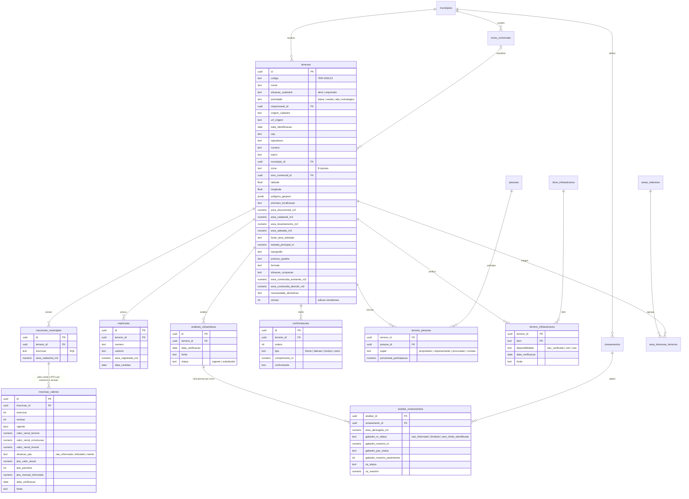
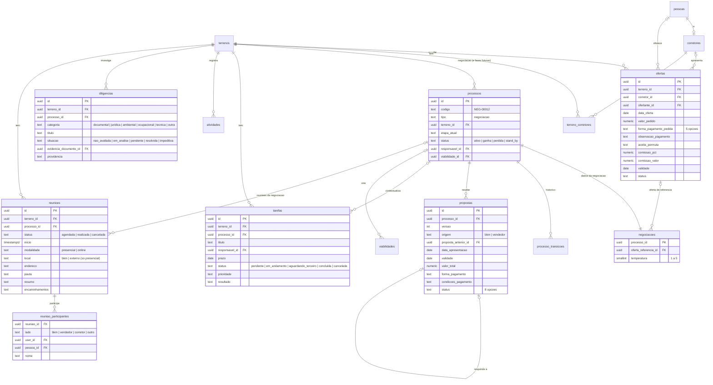
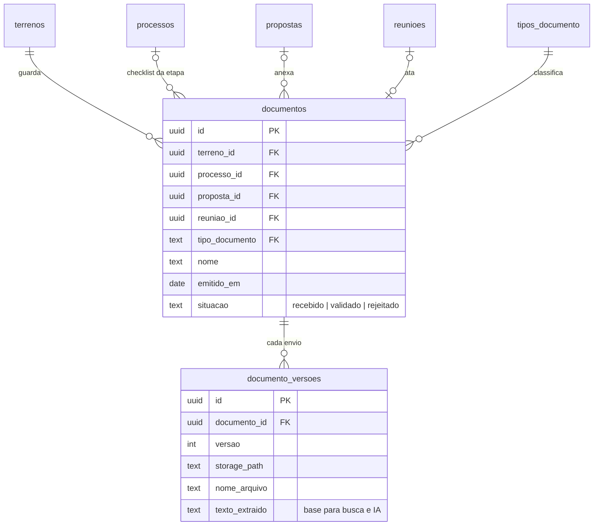

# Modelo de dados

Gerado a partir de `supabase/migrations/`. Campos de auditoria (`criado_*`, `atualizado_*`) e `empresa_id` (presente em todas as tabelas da empresa) foram omitidos. Tudo no schema `app`.

## Etapas da negociação

`Recebido → Viabilidade inicial → Negociação → Proposta → Contraproposta → Negociações comerciais → Minutagem → Ganha`. Perdida e Stand By são **status**, não etapas: acontecem em qualquer ponto e guardam a etapa em que parou.

| Para sair de | Exige |
| --- | --- |
| Viabilidade inicial | estudo de viabilidade vinculado |
| Proposta | proposta registrada |
| Negociações comerciais | última proposta aceita; entrar em Minutagem é aprovação de compra (gestor) |
| Minutagem | certidões e minuta validadas, nenhuma diligência impeditiva; virar Ganha exige gestor |

## 1. Terreno e cadastro do imóvel

## 2. Ofertas, negociação, propostas e tarefas

## 3. Documentos

## Regras que o modelo garante

| Regra | Onde |
| --- | --- |
| "Não informado" é null ou `nao_informado`, nunca zero ou "não" | defaults e checks de `terrenos`, `terreno_infraestrutura` |
| Área adotada sempre com a fonte | check em `terrenos` |
| Gabarito (m e pavimentos) e CA têm estado próprio: não informado, limitado (com valor) ou sem limite identificado | checks em `analise_zoneamentos` |
| Uma análise urbanística vigente por terreno; anteriores preservadas | índice único parcial + trigger |
| Valor venal e IPTU por inscrição e exercício; correção vira nova revisão, a anterior fica preservada | `inscricao_valores` + trigger |
| Isento não tem IPTU; venal do imóvel = terreno + construção quando os dois existem | checks em `inscricao_valores` |
| Edição simultânea: salvar com versão antiga é recusado | `terrenos.versao` + `salvar_terreno` |
| Participações dos proprietários somam no máximo 100% | trigger em `terreno_pessoas` |
| Registro não muda de terreno depois de criado | `tg_mesma_empresa` |
| Diligência impeditiva em aberto bloqueia a saída da Minutagem | `checar_avanco` |
| Papel "leitura" consulta tudo e não altera nada | políticas com `empresas_edicao()` e `exigir_editor` |
| CEP e CPF/CNPJ guardados só com dígitos; polígono GeoJSON validado | triggers e check |
| Mesma matrícula no mesmo cartório = mesmo terreno | índice único em `matriculas` |
| Um corretor principal por terreno; o primeiro da oferta vira principal | índice único parcial + trigger |
| Uma negociação aberta (ativa ou em stand by) por terreno | índice único parcial em `processos` |
| Reunião presencial tem local (BKM ou externo); online não; realizada não tem data futura | checks e trigger em `reunioes` |
| Ata só de reunião realizada do mesmo terreno; uma ata por reunião, nova ata vira versão | `registrar_documento` + índice único |
| Contraproposta do outro lado recusa a anterior; nova do mesmo lado a substitui | `registrar_proposta` |
| "Atrasada" é calculada (prazo vencido e status aberto) | `v_terrenos` |
| Documento de checklist reaproveitado; versões nunca sobrescritas | `registrar_documento` |
| Terreno nunca é apagado: arquiva com motivo, só sem negociação aberta | `arquivar_terreno` |
