# Modelo de dados

Gerado a partir de `supabase/migrations/`. Campos de auditoria (`criado_*`, `atualizado_*`) e `empresa_id` (presente em todas as tabelas da empresa) foram omitidos. Tudo no schema `app`.

## Fases

Acima das etapas fica a **fase**: o grande momento do terreno. Cada fase é um processo próprio do terreno (`processos.fase`), com etapas, subetapas, status, responsável e histórico próprios; um terreno tem no máximo um processo aberto por fase, e fases podem correr juntas.

| Fase | Prefixo | Concluído | Etapas (ponto de partida) |
| --- | --- | --- | --- |
| Novos Negócios (entrada) | NEG | Comprado | Em Triagem, Estudos Preliminares, Negociação, Contrato |
| Aprovação de Projetos | APR | Aprovado | Projeto, Análise na Prefeitura, Alvarás |
| Registro de Incorporação | INC | Incorporação registrada | Memorial e Certidões, Cartório |
| Contratação Caixa | CEF | Contratado | Análise Caixa, Contratação |
| Lançamento | LAN | Lançado | Preparação, Vendas Iniciais |
| Obras | OBR | Obra entregue | Início, Execução, Entrega |
| Entregue | ENT | Garantia encerrada | Pós-entrega (Assistência Técnica, Em Garantia) |

- **Fase de entrada** (`fases_modelo.entrada`, uma por empresa): a que a oferta abre (`abrir_negociacao`) e a única com negociação (temperatura, propostas, viabilidade). Concluir nela é a compra: pede relato e pontos de sucesso e nenhuma diligência impeditiva.
- **Dependências** (`fase_dependencias`): a fase abre quando, no mesmo terreno, a fase requisito foi concluída ou passou pela etapa ou subetapa indicada; todas precisam valer. O padrão encadeia cada fase na conclusão da anterior. Depois de cada passagem, `_abrir_fases_liberadas` abre sozinha a fase que o terreno nunca teve e cujas dependências se cumpriram (fase encerrada não reabre sozinha). Fase sem dependência, reabertura ou abertura antes da hora: `abrir_fase(terreno, fase)`, com dependência pendente só gestor ou diretor, com justificativa (`forcado`).
- **Status por fase** (`status_modelo`): Concluído e Stand By em toda fase, com o nome da fase para o Concluído; Perdido (o vendedor disse não) só em Novos Negócios; Descartado em todas menos Entregue. Status sem linha não existe na fase.
- **Fase atual do terreno** (`v_terrenos.fase`): a aberta mais adiante pela ordem; sem nenhuma aberta, a última encerrada. `fases_abertas` lista as que correm juntas; `fases_do_terreno(terreno)` dá cada fase com o processo, o status e o que falta para abrir.
- Código do processo com o prefixo da fase (`NEG-00012`, `APR-00013`), numeração única.

## Funil de cada fase

Cada fase tem etapas, cada uma com subetapas. Abaixo, as de Novos Negócios; as das outras fases são um ponto de partida que o administrador ajusta. O card está sempre numa subetapa; dentro da etapa, ela muda em qualquer ordem (a ordem é só a coluna do kanban).

| Etapa | Subetapas (colunas do kanban) |
| --- | --- |
| Em Triagem | Aguardando Informações, Aguardando Documentos, Verificação Interna |
| Estudos Preliminares | Estudo de Massa, Estudo de Viabilidade, Análise Técnica Preliminar |
| Negociação | Aguardando Primeira Reunião, Preparando Proposta, Proposta Enviada, Contra Proposta |
| Contrato | Em Elaboração, Contrato Enviado, Em Ajuste |

Entrar numa etapa leva à subetapa inicial (a primeira ativa). O fim do processo da fase é **status**, não etapa: `ativo`, `concluido` (em Novos Negócios, Comprado), `perdido`, `descartado` ou `stand_by`. Fora de ativo, o processo guarda a etapa e a subetapa onde estava (mostra onde o funil perde terrenos).

| Status | Exige | Quem |
| --- | --- | --- |
| Concluído (Comprado) | estar na última etapa; relato e pontos de sucesso (rich text); checklist da etapa e nenhuma diligência impeditiva | conforme `status_modelo` (padrão: gestor e depois diretor) |
| Perdido | motivo da lista (`motivos_encerramento`) e relato | analista ou acima |
| Descartado | motivo da lista; texto obrigatório quando o motivo pede (Outros) | analista ou acima |
| Stand By | justificativa e data futura para retomar; retomar volta à mesma etapa e subetapa | analista ou acima |

Comprado, Perdido e Descartado não voltam: se o terreno voltar ao radar, abre-se outra tratativa. Nas outras fases, Concluído pede só o relato.

**Toda passagem** (etapa, subetapa ou status) passa por `app._passagem`:

1. **Pendências** travam: checklist de documentos para sair da etapa (`checklist_modelo`), pré-requisitos (`prerequisitos_modelo`: "para entrar em X é preciso ter passado pela subetapa Y", lido do histórico) e, na compra, diligência impeditiva. Gestor ou diretor força com justificativa (`forcado` no histórico).
2. **Aprovações** configuradas por etapa, subetapa e status (`aprova_gestor`, `aprova_diretor`, `aprovacao_modo` sequência ou paralelo) viram um pedido em `aprovacoes`, menos o nível que quem move já tem: gestor dispensa gestor, diretor dispensa os dois. O card fica parado aguardando; enquanto o pedido está aberto, não se move.
3. Sem pedido, a passagem acontece na hora e vira uma linha em `processo_transicoes`.

Quem aprova: o aprovador previsto vem da hierarquia de quem pediu (`membros.superior_id`: analista → gestor → diretor). Qualquer superior dele também aprova, sempre; quem aprovou de fato fica em `decidido_por`. Em sequência, o diretor só recebe depois do gestor; em paralelo, os dois recebem juntos e a passagem acontece quando ambos aprovarem. Uma recusa (com comentário) encerra o pedido. Aprovado, a passagem é gravada no nome de quem pediu, com `aprovacao_id`.

Arrastar no quadro de etapas chama `mover_para_etapa` (para frente, etapa por etapa, e só a última pode ficar aguardando aprovação; para trás, exige motivo e grava `retorno`). No kanban da etapa, `mover_subetapa`. `checar_passagem(processo, destino_tipo, destino)` diz o que falta (padrão: a próxima etapa, ou concluir a fase na última), quais aprovações serão pedidas e o pedido aberto, com `posso_decidir` para quem vê.

**SLA:** só do histórico. `v_periodos_processo` corta o histórico em períodos (cada transição até a seguinte), com stand by em período próprio. `v_tempo_subetapas` soma por etapa e subetapa: primeira entrada, última saída, passagens, tempo ativo, tempo em stand by e se é a atual. Retomar o stand by empurra `etapa_desde` e `subetapa_desde` pelo tempo parado. Prazo estourado = agora − `subetapa_desde` > `subetapas_modelo.prazo_dias` (`v_terrenos.subetapa_atrasada`).

## Terreno com vários donos (partes)

Um dono com várias matrículas é **uma** negociação. Vários donos que negociam separado são **partes** do terreno (`terreno_partes`): cada parte é um dono, ou um grupo de donos que negocia junto (herdeiros, sócios), com as matrículas, as inscrições e as pessoas dela (`parte_id` em `matriculas`, `inscricoes_municipais` e `terreno_pessoas`; participações somam 100% em cada parte) e os corretores dela (`parte_corretores`: uma parte pode ter vários corretores e o mesmo corretor pode trazer várias partes; ligar o corretor à parte o põe entre os corretores do terreno), o pedaço da poligonal e a marca de **essencial** (sem ela o terreno não serve) ou dispensável.

- **Cadastro:** a parte pode nascer junto com o terreno (fim do Novo terreno) ou a qualquer momento na ficha, só com o nome; tamanho do lote, matrículas, inscrições, vendedores e corretor são opcionais (`salvar_parte` e os `parte_id`).
- **Antes da etapa da divisão** (`fases_modelo.etapa_partes`, só na fase de entrada; padrão Negociação) há uma negociação só, a do terreno: Triagem e Estudos são da área toda.
- **Ao chegar nela**, com duas ou mais partes ativas, cada parte ganha a sua negociação: um processo da mesma fase com `parte_id` e `principal_id` (código `NEG-00012-1`), com oferta de referência, propostas, documentos, reuniões, tarefas, subetapa, status, aprovações e histórico próprios. Parte cadastrada depois disso já nasce com a sua.
- **A negociação do terreno passa a andar pelas partes** (`_sincronizar_principal`): fica na etapa e na subetapa da parte mais atrasada em aberto, com cada mudança no histórico ("Pelas negociações das partes"), e não se move à mão. A de uma parte só anda da etapa da divisão em diante e enquanto a do terreno estiver ativa.
- **Comprado do terreno** só com todas as partes ativas compradas (pendência que nem o gestor força); o checklist de documentos fica com cada parte; relato e pontos de sucesso só na compra do terreno. A compra de uma parte não abre a fase seguinte.
- **Parte perdida ou descartada** trava a compra: ou sai do terreno (`remover_parte`, com motivo; parte essencial só com gestor ou diretor, e tornar uma parte dispensável também), ou o terreno se encerra. Parte comprada não sai.
- **Encerrar o terreno** leva as partes em aberto: Perdido e Descartado com o mesmo motivo, Stand By com a mesma data; retomar o terreno retoma as partes.
- **Oferta** pode cobrir uma ou mais partes (`oferta_partes`, com o preço de cada uma quando informado); a negociação da parte usa como referência a oferta mais recente que a cobre.
- `v_partes`: cada parte com donos, corretores, matrículas, negociação (etapa, subetapa, prazo, status), preço pedido e última proposta. A temperatura é uma só, a da negociação do terreno: `definir_temperatura` recusa a negociação de uma parte.

## Papéis, hierarquia e configuração

Papéis: `diretor`, `gestor`, `analista` (editam), `leitura` (consulta) e `basico` (entrou pelo domínio da empresa; até os perfis definitivos, consulta como `leitura`, decisão do Moisés de 28/out/2026). `membros.superior_id` liga cada analista a um gestor e cada gestor a um diretor, sempre um nível acima (trigger). `administrador` é permissão à parte, em qualquer papel: gerencia a equipe e a configuração do funil. Quem cria a empresa vira diretor e administrador.

**Login e perfil do usuário** (decisão do Moisés, 28/out/2026). Só login pelo Google do Workspace; e-mail e senha ficam desligados no Supabase Auth. `empresa_dominios` liga um domínio de e-mail (bkm.com.br) a uma empresa, editado pelo administrador. O gancho "Before User Created" do Auth chama `app.hook_antes_de_criar_usuario`, que recusa e-mail de domínio não cadastrado (o `hd` do Google é só dica na tela). No primeiro login, o trigger `t_usuario_novo` em `auth.users` cria `usuarios` (nome, e-mail, foto do Google e o `arroba`, o texto antes do @ do e-mail em minúsculas e sem acento, único, com número no fim se repetir) e o membro `basico` da empresa do domínio. A cada login, nome, foto e e-mail se atualizam (`t_usuario_login`); o @ fica, e só o administrador o muda (`app.mudar_arroba`). Quem cada um vê em `usuarios`: o próprio perfil e os de quem está nas suas empresas. O primeiro administrador é promovido à mão no banco. As chaves do Google para Agenda e Gmail (refresh token) não passam pelo navegador nem ficam em tabela legível: ficam no Vault, gravadas por uma função do servidor (a fazer).

A configuração do funil é **por empresa** (`empresa_id`); as linhas com `empresa_id` nulo são o modelo padrão, copiado para cada empresa nova. O administrador edita pelo app, só por RPC, e toda alteração vai para a auditoria:

| O quê | RPC | Não pode |
| --- | --- | --- |
| Fases: criar, renomear, reordenar, prefixo, desativar; etapa em que a negociação se divide por parte (`etapa_partes`) | `salvar_fase`, `apagar_fase` (só sem processo) | mudar ou desativar a fase de entrada; desativar com terreno dentro; dividir fora da fase de entrada; mudar a divisão com partes negociando |
| Dependências entre fases | `adicionar_dependencia`, `remover_dependencia` | ciclo; dependência na fase de entrada |
| Etapas: criar (nasce com uma subetapa), renomear, reordenar, prazo, aprovações | `salvar_etapa`, `apagar_etapa` (só sem histórico) | apagar etapa de que outra fase depende |
| Subetapas: criar, renomear, reordenar, prazo, aprovações, desativar | `salvar_subetapa` (desativar com terrenos dentro pede `mover_para`) | mudar de etapa; apagar com histórico (`apagar_subetapa` só sem histórico); desativar de que um pré-requisito depende |
| Pré-requisitos | `adicionar_prerequisito`, `remover_prerequisito` | ciclo; exigir subetapa de etapa posterior; exigir na subetapa inicial outra da própria etapa |
| Motivos de encerramento | `salvar_motivo`, `apagar_motivo` (só nunca usado) | |
| Checklist de documentos por etapa | `salvar_checklist`, `remover_checklist` | |
| Status da fase: nome, aprovações, incluir ou tirar (Perdido, Descartado) | `configurar_status` | tirar Concluído ou Stand By; tirar status em uso |
| Tipos de notificação, lembretes e e-mail padrão | `configurar_notificacao` | |
| Receber ou não por e-mail, por tipo (cada um o seu) | `salvar_preferencia_notificacao` | |

```mermaid
erDiagram
  empresas ||--o{ membros : equipe
  membros |o--o{ membros : "superior"
  fases_modelo ||--o{ etapas_modelo : tem
  fases_modelo ||--o{ status_modelo : encerra
  fases_modelo ||--o{ fase_dependencias : "abre quando"
  fases_modelo ||--o{ processos : "terreno na fase"
  etapas_modelo ||--o{ subetapas_modelo : tem
  etapas_modelo ||--o{ checklist_modelo : "para sair"
  subetapas_modelo ||--o{ prerequisitos_modelo : "requisito"
  processos ||--o{ aprovacoes : pede
  processos ||--o{ processo_transicoes : historico
  aprovacoes |o--o{ processo_transicoes : libera

  membros {
    uuid user_id PK
    text papel "diretor | gestor | analista | leitura | basico"
    uuid superior_id FK "um nivel acima"
    bool administrador
  }
  fases_modelo {
    uuid empresa_id "null = modelo padrao"
    text codigo
    text nome
    int ordem
    text prefixo "NEG, APR..."
    bool entrada "a que a oferta abre"
    bool ativo
  }
  fase_dependencias {
    uuid id PK
    text fase
    text requisito_fase
    text requisito_tipo "conclusao | etapa | subetapa"
    text requisito
  }
  etapas_modelo {
    uuid empresa_id "null = modelo padrao"
    text fase FK
    text codigo
    text nome
    int ordem
    int sla_dias
    bool aprova_gestor
    bool aprova_diretor
    text aprovacao_modo "sequencia | paralelo"
  }
  subetapas_modelo {
    text codigo "unico na fase"
    text etapa FK
    text nome
    int ordem "coluna do kanban"
    int prazo_dias
    bool aprova_gestor
    bool aprova_diretor
    text aprovacao_modo
    bool ativo
  }
  status_modelo {
    text fase FK
    text status "concluido | perdido | descartado | stand_by"
    text nome "Comprado, Aprovado..."
    bool aprova_gestor
    bool aprova_diretor
    text aprovacao_modo
  }
  prerequisitos_modelo {
    uuid id PK
    text alvo_tipo "etapa | subetapa"
    text alvo
    text requisito "subetapa"
  }
  motivos_encerramento {
    text status "descartado | perdido"
    text codigo
    text nome
    bool exige_texto
    bool ativo
  }
  aprovacoes {
    uuid id PK
    uuid pedido_id "uma linha por nivel"
    uuid processo_id FK
    text destino_tipo "etapa | subetapa | status"
    text destino
    text nivel "gestor | diretor"
    smallint ordem "2 = diretor em sequencia"
    uuid aprovador_previsto
    uuid pedido_por
    text status "pendente | aprovado | recusado | cancelado"
    uuid decidido_por
    text comentario
    jsonb dados "forcado, justificativa, dados do encerramento"
  }
  processo_transicoes {
    uuid id PK
    text evento "abertura | avanco | retorno | subetapa | conclusao | perda | descarte | stand_by | retomada | temperatura"
    text de_etapa
    text para_etapa
    text de_subetapa
    text para_subetapa
    bool forcado
    uuid aprovacao_id FK
    uuid user_id
    timestamptz em
  }
```

## Notificações e lembretes

`notificacoes` é genérica: destinatário, tipo, texto, autor, terreno e origem (tabela e id). Cada usuário vê só as suas; só o banco cria (`_notificar`), e `marcar_notificacao_lida(id)` marca uma ou todas. A chave única (tipo, origem, destinatário, `referencia`) impede aviso repetido. O sino ouve a tabela pelo Realtime do Supabase.

| Tipo | Gatilho | Quem recebe |
| --- | --- | --- |
| `tarefa_atribuida` | na hora (trigger em `fluxo.tarefas`, `fluxo.tarefa_pessoas` e `fluxo.checklist_itens`) | responsável, executor incluído, responsável do item do checklist |
| `mencao` | na hora, @arroba no texto (trigger em `fluxo.tarefas`, `fluxo.comentarios`, `atividades`, `reunioes`) | pessoa mencionada |
| `tarefa_prazo` | lembrete (padrão: no dia) | responsável |
| `tarefa_atrasada` | rotina diária, uma vez por prazo | responsável |
| `tarefa_acompanhada` | na hora: comentário novo e tarefa concluída (no máximo um aviso por tarefa por dia) | quem acompanha a tarefa |
| `stand_by_retomar` | lembrete (padrão: 7 dias antes e no dia) | responsável da tratativa |
| `subetapa_prazo` | rotina diária, uma vez por entrada na subetapa | responsável da tratativa |
| `documento_vencendo` | lembrete (padrão: 30 e 7 dias antes) | responsável da tratativa ou do terreno |
| `reuniao_agendada` | lembrete (padrão: 1 dia antes) | responsável da tratativa ou do terreno |
| `aprovacao_pendente` | na hora, quando é a vez | aprovador previsto (ou todos do nível) |
| `aprovacao_decidida` | na hora | quem pediu |

**Menções com @** (decisão do Moisés, 28/out/2026): quem escreve `@arroba` (o @ de `usuarios`) na descrição, no resultado ou num comentário da tarefa, no resumo ou no resultado da atividade, ou na pauta, no resumo ou nos encaminhamentos da reunião avisa a pessoa (`app.tg_mencoes`, que lê os @ por `app.arrobas_no_texto`). Só conta o @ de quem é da empresa; o autor não avisa a si mesmo, e-mail escrito no texto não é menção, e editar o texto só avisa quem entrou agora. Cada menção fica em `mencoes` (origem e pessoa, uma vez). Só o @ avisa: não há lista de marcados na tarefa (decisão do Moisés, 29/out/2026, para não virar spam).

**E-mail:** cada tipo tem o padrão da empresa (`tipos_notificacao.email_padrao`; nascem ligados os de atribuição, menção e aprovação) e cada pessoa escolhe por tipo em `preferencias_notificacao` (`app.salvar_preferencia_notificacao(empresa, tipo, email)`; nulo volta ao padrão). A notificação que vai por e-mail nasce com `email_status = 'pendente'`; uma função do servidor (a fazer) envia pela conta do sistema (bkm@) e marca `enviado` ou `falhou`. No app a notificação sempre aparece; o administrador desliga o tipo inteiro. WhatsApp fica para depois (decisão do Moisés, 28/out/2026).

`lembretes`: um por item e antecedência (`dias_antes`, destinatário nulo = responsável do item). Nascem com o item pelos padrões de `tipos_notificacao.dias_antes_padrao`, e quem cadastra pode incluir ou tirar. `enviado_para` guarda a data já avisada: se a data do item mudar, o lembrete volta a valer. `app.rotina_diaria()` roda às 6h pelo pg_cron (agendada na migration quando a extensão existe).

## 1. Terreno e cadastro do imóvel

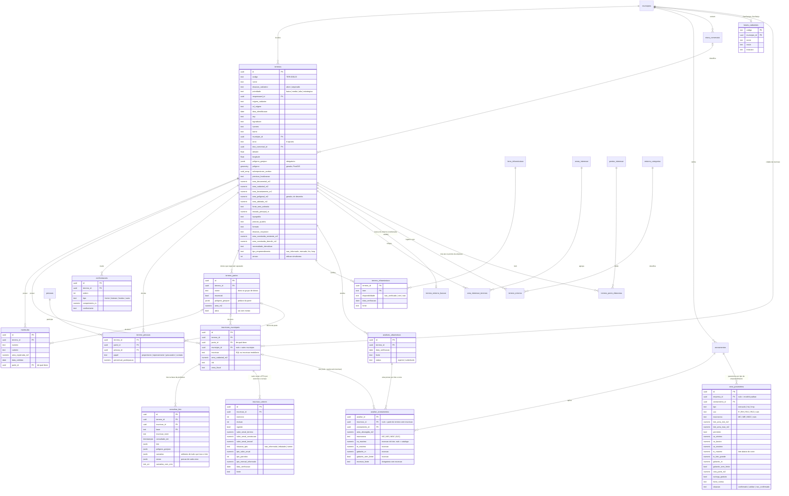

`municipios` traz os 5.571 municípios do IBGE (código, nome e UF), então o terreno pode estar em qualquer cidade. A busca de endereço do Google devolve cidade e UF, e o front obtém o `municipio_id` por `app.municipio_por_nome(nome, uf)`, que compara sem acento, maiúsculas, hífen ou apóstrofo. O catálogo de `zoneamentos` tem São Paulo (LPUOS) e São José dos Campos (LC 623/2019, siglas da legenda do mapa do GeoSanja).

**Parâmetros urbanísticos por lote e zona** (decisão do Moisés, 25/out/2026). O parâmetro é da zona, aplicado à parte do lote que ela cobre, e o CA muda com o tipo de empreendimento. Por isso:
- `zona_parametros` é o que a lei diz para cada zona, por tipo (`mercado`, `his`, `hmp`; em SP, `his` é o EHIS, ou o EZEIS nas ZEIS, e `hmp` o EHMP) e, quando a lei separa, por uso (SJC: R, RH, RV1, RV2), macrozona (SJC: MC, ME, MOC) e tamanho do lote (SP: ZEIS em lote pequeno). É configuração por empresa, copiada do modelo padrão (empresa nula), que o administrador edita por `app.salvar_zona_parametro` (com auditoria; desativar em vez de apagar). Cada linha leva a fonte (norma, dispositivo, link) e a situação (`confirmado`, `validar`, `nao_confirmado`). A carga inicial vem da pesquisa de 25/out/2026 (Quadro 3 da LPUOS e Quadro 2 do Decreto 63.728/2024 em SP; Anexo VI da LC 623/2019 em SJC), aceita como correta até o Moisés validar.
- `analise_zoneamentos` tem uma linha por lote (`inscricao_id`) e zona, com a área da zona no lote e a macrozona; `inscricao_id` nulo é a parte do terreno sem inscrição, com a zona tirada pela poligonal (`app.registrar_zonas_sem_inscricao`). Os números saem do catálogo; na linha ficam só os valores que o usuário alterou naquele lote (qualquer parâmetro: CA mínimo, básico e máximo, TO, gabarito, recuos, cota-parte, unidades, permeabilidade, lote e frente mínimos, outorga), sempre com a fonte, porque o preenchimento automático não é definitivo.
- A consulta de um lote (`registrar_consulta_lote`, por `app._substituir_zonas`) cria uma análise nova que copia os outros lotes da vigente e troca só as zonas desse lote, levando as exceções das zonas que continuam; se as zonas do lote não mudaram, nada é gravado. Assim um lote nunca apaga o outro.
- `app.parametros_zona(empresa, zona, tipo, macrozona, área do lote, uso)` escolhe a linha: a do tipo pedido ou, sem regra própria, a de mercado (o campo `tipo` diz qual valeu); a mais específica em macrozona e uso; sem uso, a permitida, preferindo o vertical. A condição de tamanho de lote usa a área adotada do terreno, que é o lote do empreendimento; sem área, vale a de lote grande. Em SJC, sem macrozona não há parâmetro (não informado).
- `v_lote_zonas` dá cada lote × zona × tipo com os parâmetros e o potencial construtivo (área × CA); `v_urbanismo_vigente` resume o terreno: todas as zonas, o maior CA de mercado e o potencial por tipo (nulo se algum pedaço não tem CA ou não admite o tipo). Nunca um "CA médio". As zonas saem separadas por barra ("ZC / ZM / ZEU"), da maior área para a menor.
- O terreno guarda o tipo de empreendimento pretendido (`terrenos.tipo_empreendimento`: mercado, HIS ou HMP; escolhido no Novo terreno em São Paulo e mudado na seção de parâmetros). `v_urbanismo_vigente.potencial_tipo_m2` é o potencial desse tipo; sem tipo informado, fica nulo (nunca vira mercado sozinho).
- As camadas que a consulta do lote trouxe (Conpresp, tombamento, ZEIS, mananciais, operação urbana, macrozona, centralidade...) ficam na consulta (`consultas_lote`), e a seção de parâmetros mostra as da última consulta de cada lote.

**Poligonal primeiro.** O cadastro começa pela poligonal, obrigatória (`check` em `terrenos`; PostGIS no schema `extensions`, coluna gerada `poligono` com índice GiST). Antes de criar, o front chama `app.terrenos_sobrepostos(empresa, poligonal)`, que usa `app.sobreposicao(a, b, folga = 5 m)`: a parte em comum conta quando passa de 1 m² e tem mais de 5 m de largura (diâmetro do maior círculo que cabe nela, `ST_MaximumInscribedCircle` na UTM do lugar) ou cobre metade de um dos dois. Assim a imprecisão do desenho na divisa não conta, mas o mesmo lote estreito desenhado de novo sempre avisa. Cada achado vem como `mesma_area` (90% ou mais dos dois lados) ou `parcial`, com área, largura e percentuais. O usuário escolhe: nova oferta no existente (com `ofertas.poligono_geojson` quando oferece só parte, conferido em `registrar_oferta` para caber no terreno com 5 m de folga), recadastrar o existente com a área nova ou a soma das duas (`salvar_terreno`), ou confirmar que é outro terreno. Nesse caso os ids vão em `sobreposicoes_aceitas`, e o trigger `t_sobre` recusa qualquer poligonal (cadastro, edição, importação) que ocupe outro terreno sem essa confirmação. Município e endereço vêm da localização da poligonal (geocodificação reversa no front, com `municipio_por_nome`); as ruas de cada lado viram as frentes, o usuário escolhe a principal (`logradouro`, `numero`) e as outras entram em `confrontacoes` com tipo `frente`.

**Inscrição por cidade.** Cada inscrição guarda a cidade (`municipio_id`), escolhida antes de digitar: São Paulo, São José dos Campos ou outro município (nulo, inscrição digitada). A cidade com base da prefeitura está em `bases_cadastrais`, com o nome da base, como a prefeitura chama a inscrição e a máscara (`000.000.0000-0` em SP, `00.0000.0000.0000` em SJC); o front abre o campo com essa máscara e busca o lote na base. A inscrição de uma cidade tem que ser da cidade do terreno (trigger `tg_inscricao_municipio`), e a unicidade é por empresa, cidade e número. Nos dois cadastros os 6 primeiros dígitos são setor e quadra, o que dá o aviso de "mesma quadra" em `buscar_duplicados`. A consulta do lote, nas duas bases, é gravada por `app.registrar_consulta_lote` em `consultas_lote` (campo `base`), e planta e desenho são os documentos `lote_pdf` e `lote_dxf`.

**GeoSampa pelo SQL (São Paulo).** Na inscrição, "Buscar no GeoSampa" (automático ao cadastrar o SQL) consulta o servidor de camadas do Novo GeoSampa (`geoserver.geosampa.prefeitura.sp.gov.br`, WFS/WMS) pelo repasse do Caddy em `/geosampa`, porque o servidor só aceita chamadas de navegador vindas do próprio GeoSampa. Traz o lote fiscal (`lote_cidadao`: poligonal em UTM 23S SIRGAS 2000, áreas, uso, CIB, condomínio) e os atributos de cada camada que toca a poligonal (zoneamento das Leis 18.081 e 18.177, ZEIS, eixos, macroárea e fator de planejamento, operação urbana, mananciais, tombamento e áreas envoltórias, áreas contaminadas, melhoramento viário, faixa não edificável, córrego a até 50 m, risco, inundação, influência de Metrô e CPTM, vegetação significativa, zona fiscal). `app.registrar_consulta_lote` confere que o lote é o da inscrição, grava a consulta inteira (nunca alterada), completa só o que está vazio na inscrição (área cadastral) e o cadastro fiscal (CIB, zona fiscal) e, se pedido, troca as zonas desse lote (com a área de cada uma) na análise urbanística, sem mexer nos outros lotes. Poligonal e áreas do terreno continuam passando por `app.salvar_terreno`. A planta (PDF, gerada pelo próprio servidor) e o desenho (DXF R12 com lotes, calçada, quadra, edificações, curvas de nível com cota e pontos cotados, montado no navegador) entram como documentos `lote_pdf` e `lote_dxf`, com versão. Testada, valor do m² e valor venal não estão no GeoSampa novo; continuam digitados por exercício em `inscricao_valores`.

**GeoSanja pela inscrição imobiliária (São José dos Campos).** Não há serviço público de camadas: a ficha usa a API do próprio site (`geo.sjc.sp.gov.br/v1`) com o token de visitante (`autenticar?token=VISITANTE`, vale um ano), pelo repasse do Caddy em `/geosanja` (o site não libera CORS). A busca pela inscrição (`localizar`, ferramenta `SearchICTool`) devolve só a poligonal do lote, sem área cadastral, uso nem endereço. As camadas liberadas ao visitante são lidas por `GetFeatureInfo` com raio cobrindo o lote e conferidas no navegador contra a poligonal: zona da LC 623 com a área no lote e o link da ficha da zona, macrozona, área de desenvolvimento estratégico, centralidade com o CA máximo, região, setor e subsetor, corredores, recarga de aquífero, parques e unidades de conservação, núcleos informais, risco de escorregamento e PMRR, linha de transmissão e ferrovia. A planta é montada no navegador (ortofoto de 8 cm, curvas e zoneamento, com o lote em vermelho, num PDF de uma página) e o DXF leva lote, arruamentos, curvas do IGC (1:10.000, cota como elevação) e zonas, em UTM 23S SIRGAS 2000. Fechadas ao visitante: atributos do lote, inundação, APAs estaduais e federais, bens tombados, loteamentos e circunscrição imobiliária. É uma API interna da prefeitura, que pode mudar sem aviso.

**Topográfico preliminar (decisão do Moisés, 26/out/2026).** O botão Topográfico, na seção Relevo da Visão geral, monta um levantamento preliminar só no navegador, sem tabela nova. Contorno: a soma dos lotes da prefeitura quando todas as inscrições com base (GeoSampa, GeoSanja) têm o lote, senão a poligonal desenhada; a área levantada vai até 30 m em volta. Em São Paulo sem SQL (decisão do Moisés, 27/out/2026), a área levantada é a quadra inteira que a poligonal ocupa (o quarteirão entre as ruas, `quadra_viaria_editada`, com pelo menos 5% da poligonal; a quadra fiscal não serve porque pode juntar vários quarteirões, e quadra acima de 6 ha e de 3 vezes o terreno fica de fora, só com os lotes até 30 m do terreno) mais os 30 m, e todos os lotes ativos dela (`lote_cidadao`) são desenhados (layer `LOTES_QUADRA`) e numerados pelo SQL: no PDF, lote e dígito dentro de cada lote, setor e quadra na lateral; no DXF, o SQL completo em `NUMERO_LOTES`. Nesse caso o PDF é uma folha só, na escala que o terreno + 30 m teria em A3 (a mesma do caso com SQL), na menor folha em que a quadra cabe (A2, A1 ou A0; se nem o A0 couber, A0 na escala que couber); a ortofoto de folha grande vem em pedaços (o servidor recusa acima de ~4.000 px). Cotas: em São Paulo, sempre o laser de 2020 da prefeitura (MDT 1:1000, folhas `.laz` da articulação `quadricula_folha_mdt_mds_2020`, baixadas do Novo GeoSampa pelo repasse `/geosampa/Download/File/125` e lidas com o laz-perf), média por célula de 1 m, buracos preenchidos pelos vizinhos e leve suavização; confere com as cotas de esquina da prefeitura em cerca de 0,2 m e, contra 4 levantamentos de campo (27/out/2026), em 6 a 9 cm na forma do terreno. Cada folha e cada consulta ao GeoSampa tenta 3 vezes; se ainda falhar, a janela mostra o erro e "Tentar de novo": em São Paulo nunca se usa o Google (decisão do Moisés, 27/out/2026). Fora de São Paulo, o Google Elevation numa grade de 5 m interpolada para 1 m: a grade de origem do Google tem 9,5 m e, contra o laser, erra 3,7 m em média (medido em 26/out/2026), então pontos mais densos que isso só encarecem. Curvas de 1 em 1 m, mestra de 5 em 5 (de 2 e 5 m em desníveis acima de 120 e 300 m); no PDF, intermediárias verde neon com 0,75 mm em 4 tons entre duas mestras (a mais alta a mais escura, a mais baixa a mais clara) e mestras roxo neon com 1 mm, com contorno preto fino para ler sobre a foto (decisão do Moisés, 27/out/2026); no DXF, `CURVA_INTERMEDIARIA_1` a `_4` (cores 102, 3, 80 e 71, da mais alta à mais baixa) e mestra roxa (cor 190); o contorno do terreno é azul neon com 2 mm (no DXF, cor 4). O DXF não copia as espessuras do PDF: cada layer tem a espessura usual de desenho topográfico (divisa do terreno 0,50 mm, mestra 0,35, intermediárias 0,13, quadras 0,25, lotes e calçadas 0,18; `topo_dxf_modelo.py`). Imagem: ortofoto da prefeitura (São Paulo 2023/24, São José dos Campos nov/2025), senão Google Maps Static ou Esri. Do GeoSampa entram lotes, alinhamento das quadras, calçadas com a largura média, eixos com o nome da via, edificações, córregos (canalizados à parte), corpos d'água e melhoramentos viários, e a largura da via e do leito é medida na perpendicular ao eixo, entre as calçadas; do GeoSanja, arruamentos, faixa de curso d'água e as curvas do IGC. Saídas: PDF A3 (escala padrão que cabe, coordenadas UTM nas bordas, legenda, fonte e precisão das cotas, aviso de que não substitui levantamento com ART/RRT) e ZIP com o mesmo PDF e o DXF 2000 (curvas com a cota como elevação, malha de pontos cotados a cada 5 m, camadas da prefeitura, medidas dos lados) e a ortofoto como imagem referenciada (com `.jgw`); o esqueleto do DXF sai do `tools/prototipo/topo_dxf_modelo.py`. O DWG sai do AutoCAD (Salvar como); imagem nunca vai dentro do DWG. Os dois arquivos entram em Documentos (`topo_pdf`, `topo_dxf`) com versão. Com cotas do Google, a planta (curvas feitas sobre a poligonal) é guardada, mas os pontos do Google não: o DXF sai sem a malha de pontos cotados, só com as curvas e a cota de cada uma em texto (`COTA_CURVA`) (decisão do Moisés, com o advogado, 27/out/2026).

## 2. Ofertas, negociação, propostas e tarefas

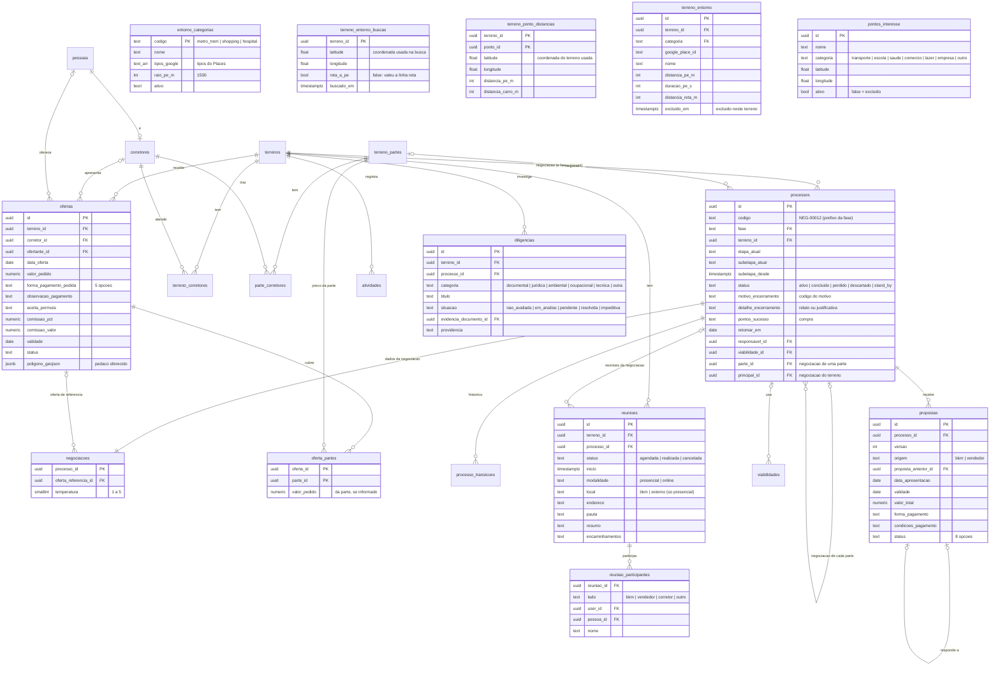

As tarefas moram no esquema `fluxo` (ver "Quadros e tarefas", abaixo): cada terreno tem o seu quadro e a tarefa pode apontar a negociação (`processo_id`, do mesmo terreno do quadro).

## Mapa, dashboard e quadro de tarefas

| View / função | Para quê |
| --- | --- |
| `v_mapa` | um pin por terreno ativo, com `situacao_mapa` (sem negociação, etapa do processo atual, ou o status dele: concluido, perdido, descartado, stand by), a fase atual e as abertas (filtro por fase), a subetapa e a poligonal |
| `v_terrenos` (para os filtros) | além da ficha resumida: `uf` e `municipio_id`, `vgv` e `margem_pct` da viabilidade, `corretor_ids` (todos os corretores do terreno, inclusive os das partes), `proposta_ativa_valor` (última proposta apresentada, em análise ou aceita; dividido em partes, a soma das partes), `tem_partes`, `zonas_siglas` da análise vigente e `ultima_movimentacao_em` (atividade, reunião realizada ou passagem do funil). O mapa filtra pelos mesmos campos, cruzando `v_mapa` com `v_terrenos` pelo id |
| `filtros_salvos` | visões salvas dos filtros: nome e filtros (jsonb do front), pessoais (`user_id` de quem criou; só ele vê e muda) ou da empresa (`user_id` nulo; todos veem, só o administrador cria, muda ou apaga). Escrita direta, pela RLS |
| `v_terreno_pontos` | todos os pontos de interesse da empresa para cada terreno localizado: linha reta sempre; a pé e de carro pela rota quando medidos para a coordenada atual (`precisa_medir` quando não) |
| `salvar_distancias_pontos(terreno, lat, lng, itens)` | grava as distâncias pela rota (a pé e de carro) do terreno aos pontos da empresa; recusa coordenada diferente da atual |
| `distancia_km(lat1, lng1, lat2, lng2)` | haversine; rota de verdade vem do serviço de mapas |
| `salvar_entorno(terreno, lat, lng, itens, rota_a_pe)` | grava a busca do entorno feita no navegador (Places `searchNearby` por categoria + Routes `computeRouteMatrix` a pé), trocando a anterior; recusa coordenada diferente da atual, descarta categoria inativa e lugar além do raio a pé, e grava cada lugar uma vez |
| `v_terreno_entorno` | lugares do entorno com categoria, distância e tempo a pé e `desatualizado` (o terreno mudou de lugar depois da busca); sem os lugares excluídos no terreno |
| `excluir_lugar_entorno(terreno, google_place_id)` | exclui um lugar do Google do entorno deste terreno (`excluido_em`/`excluido_por`); `salvar_entorno` mantém a exclusão quando a busca é refeita |
| `restaurar_lugar_entorno(terreno, google_place_id)` | desfaz a exclusão; o lugar volta à ficha sem nova busca |
| `v_entorno_buscas` | por terreno localizado: quando foi buscado, se a rota a pé respondeu e `precisa_buscar` (nunca buscado ou desatualizado) |
| `v_tarefas` | cartão dos quadros dos terrenos (`fluxo.v_tarefas`: lista, atraso e andamento do checklist) com o código e o nome do terreno; o quadro ordena por lista e `posicao` |

Entorno do terreno: as categorias são configuração (`entorno_categorias`: tipos do Google e raio a pé; ligar outra categoria é migration de dados). O front busca sozinho quando o terreno é localizado ou muda de lugar (`precisa_buscar`), e só então, e grava por `salvar_entorno`. `pontos_interesse` é a lista cadastrada pela própria empresa (sede, polos, pontos marcados à mão): todos aparecem na ficha de cada terreno, com a distância a pé quando está a até 1,5 km a pé e de carro quando está mais longe (`terreno_ponto_distancias`). Excluir: lugar do Google é marcado no próprio terreno por `excluir_lugar_entorno` (só aquele terreno; continua fora se a busca for refeita porque o terreno mudou de lugar) e volta por `restaurar_lugar_entorno`; ponto da empresa é desligado direto (`ativo = false`, auditado), some de todos os terrenos e do mapa e pode ser religado. A busca no Google é feita uma vez por localização: não há "buscar de novo" manual.

O dashboard agrega `v_terrenos` no front (filtro cruzado por clique). A poligonal continua em `terrenos.poligono_geojson`; importar KMZ/KML é feito no front e gravado por `salvar_terreno`.

## Quadros e tarefas (esquema `fluxo`)

Módulo de quadros e tarefas, o "Trello da BKM" (decisões do Moisés, 29/out/2026; modelo em https://claude.ai/artifact/EdJyXjystX3uEGo4sNQob4). Mora no esquema próprio `fluxo` (migration `00150`), que só conhece empresas, membros e usuários, para servir também a outros apps do mesmo Supabase: o quadro aponta para o que acompanha por `objeto_tipo` e `objeto_id`, sem chave estrangeira. O BKM Terrenos cria um quadro por terreno (trigger `t_quadro` em `terrenos`, por `fluxo.quadro_de`) e liga a tarefa ao processo (chave estrangeira e `app.tg_tarefa_processo`, em `negociacao`). No Supabase, `fluxo` entra em **Settings → API → Exposed schemas** junto com `app`.

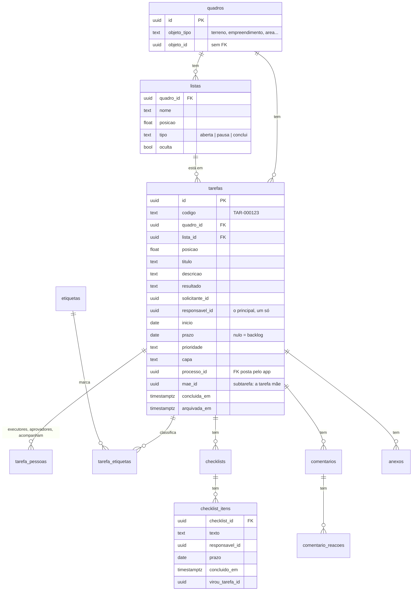

- **Listas:** `listas_modelo` traz o padrão da empresa (nulo = modelo de fábrica: Backlog, Fazer, Fazendo, Aguardando retorno, Pausadas, Feito), copiado para cada quadro novo; os quadros existentes mantêm as suas, e cada terreno cria, renomeia, ordena e oculta as dele. Só o administrador muda o padrão (`fluxo.salvar_lista_modelo`, que copia o padrão para a empresa na primeira mudança e recusa ficar sem lista que conclui).
- **Concluir:** a tarefa não tem status. Entrar numa lista do tipo `conclui` preenche `concluida_em` e `concluida_por`; sair dela reabre; marcar `concluida_em` à mão leva o cartão para a primeira lista que conclui, e limpar leva para a primeira aberta (`fluxo.tg_tarefa_lista`). A lista `pausa` é a que vai pausar o SLA (bloco 3).
- **Nunca apagada:** sem `delete` em `tarefas`, `listas` e `etiquetas`; a tarefa arquiva (`arquivada_em`, `arquivada_por`) e restaura. Comentário: só o autor edita (`editado_em`) e apaga (`apagado_em`, o texto some da tela e fica na auditoria). Anexo sai com `removido_em`.
- **Pessoas:** solicitante (quem criou, por padrão) e responsável principal ficam no cartão; executores, aprovadores e quem acompanha em `tarefa_pessoas`.
- **Predecessora pendente** (30/out/2026): `fluxo.predecessoras_pendentes(tarefa)` devolve os códigos das predecessoras que ainda não deixam concluir (TI e TT: em aberto; II e IT: em aberto e com o início nulo ou no futuro, porque o início real não é guardado; arquivada não conta). Por padrão o app só avisa ("Concluir mesmo assim", registrado no histórico); com `regras.conclui_exige_predecessoras` (`fluxo.salvar_regra_predecessoras`, só administrador), vira a pendência `predecessoras` e `tg_tarefa_lista` e `pedir_aprovacao` recusam.
- **Subtarefas** (30/out/2026): `mae_id` liga a subtarefa à mãe, no mesmo quadro e com um nível só (a mãe não é subtarefa, quem tem subtarefas não vira subtarefa, modelo só com modelo; `fluxo.tg_subtarefa`). Com a regra do checklist ligada, a mãe não conclui com subtarefa aberta e não arquivada (`pendencias_conclusao` devolve `subtarefas`; `tg_tarefa_lista` recusa).
- **Checklist:** vários por cartão, item com responsável e prazo; `fluxo.item_para_tarefa(item)` cria o cartão no mesmo quadro, ligado ao de origem por anexo, e marca o item como feito.
- **Escrita direta** de quem edita (diretor, gestor, analista), pela RLS por `empresa_id`; Leitura só vê. Todas as tabelas vão para `app.auditoria` (o vínculo sem id próprio registra a tarefa).
### Cronograma (bloco 2) e modelos de tarefas

Decisões do Moisés de 29/out/2026. Mesmo esquema `fluxo`, mesma migration.

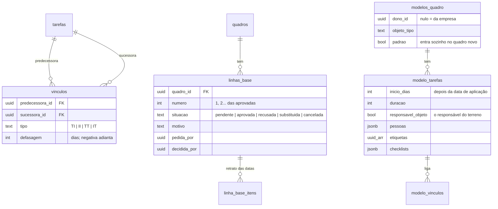

- **Datas como no Project ("o mais cedo possível"):** a tarefa ganha `duracao` (dias no calendário da empresa) e `inicio_min` (o início que a pessoa digitou, a restrição "não começar antes de"). `fluxo.tg_cronograma` põe a tarefa no maior entre `inicio_min` e o que os vínculos pedem (`fluxo.inicio_cedo`): TI começa no dia seguinte ao fim da predecessora, II no início dela, TT termina no fim dela e IT termina no início dela, sempre mais a defasagem; a duração se mantém. Mudar só o início move a tarefa inteira; mudar o prazo ou a `duracao` muda a duração. Mudou uma tarefa, as sucessoras se reposicionam em cascata (`fluxo.reprogramar_sucessoras`, com `fluxo.cascata = 1` para não tomar a data empurrada como digitada); tarefa concluída não se move. Vínculo em círculo é recusado. II e TT juntos com durações diferentes seguem o Project (a sucessora termina junto e começa depois); o front pergunta se estica a duração da sucessora (grava `duracao`) ou adia o início.
- **Calendário:** dias corridos por padrão; o administrador passa a empresa para dias úteis (`fluxo.salvar_calendario`), que pulam sábado, domingo e `feriados` (nacionais de 2026 a 2030, com Carnaval e Corpus Christi; a empresa pode ter os seus). `fluxo.somar_dias` e `fluxo.duracao_dias` fazem a conta nos dois modos.
- **Linha de base:** `fluxo.enviar_cronograma(quadro, motivo)` tira o retrato das tarefas não arquivadas com início e prazo; quem edita manda, e fica `pendente` até o gestor de quem mandou (ou alguém acima, um diretor ou o administrador) decidir (`fluxo.decidir_linha_base`, que também deixa quem pediu desistir). Quem já aprova tem a sua aprovada na hora. Depois da primeira, trocar pede motivo; a anterior vira `substituida` e fica guardada. As datas seguem livres depois da aprovação: `fluxo.v_cronograma` mostra a linha de base aprovada, o desvio de início e de prazo em dias e `atrasada_base`; quem mudou cada data está em `app.auditoria` (as empurradas pela cascata ficam com quem fez a mudança que as empurrou).
- **Modelos de tarefas:** o modelo da empresa (`dono_id` nulo) só o administrador mexe e pode ser o padrão do tipo de quadro (`fluxo.definir_modelo_padrao`): entra sozinho no quadro novo (no terreno, pelo `t_quadro`, com o responsável do terreno onde o modelo pede). Cada pessoa cria os seus (só ela vê) e aplica à mão (`fluxo.aplicar_modelo(modelo, quadro, data)`). O modelo guarda lista, prioridade, prazos relativos (`inicio_dias`, `duracao`), responsável fixo ou o do objeto, aprovadores, executores e quem acompanha, etiquetas, checklists e as predecessoras (`modelo_vinculos`), que ao aplicar já empurram as datas. `fluxo.salvar_quadro_como_modelo` transforma os cartões abertos de um quadro em modelo, com os prazos relativos ao primeiro início.

### Aprovação formal da tarefa (bloco 3)

Decisões do Moisés de 29/out/2026. Mesmo esquema `fluxo`, mesma migration.

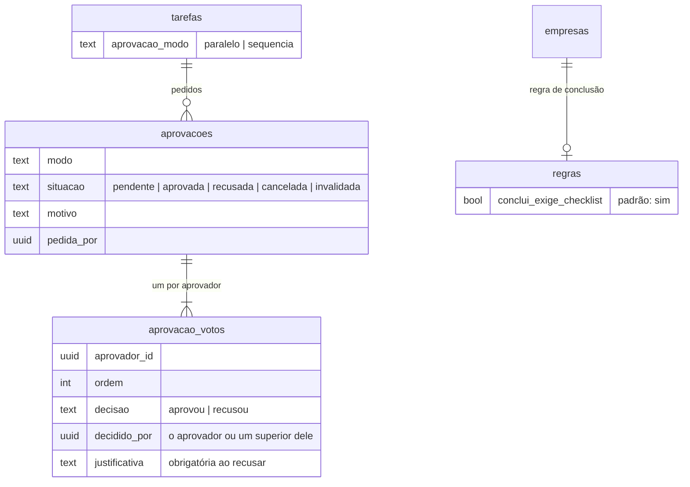

- **Quem aprova:** os aprovadores do cartão (`tarefa_pessoas`, papel `aprovador`, com `ordem` para a sequência). Um superior de um aprovador decide no lugar dele, como no funil; o voto guarda `decidido_por`.
- **Pedido:** `fluxo.pedir_aprovacao(tarefa, motivo)` tira o retrato dos aprovadores; o pedido aberto anterior é cancelado e o aprovador que pede tem o próprio voto dado. Em paralelo (padrão) todos aprovam, em qualquer ordem; em sequência, só o da vez decide (`fluxo.votos_da_vez`). `fluxo.decidir_aprovacao(aprovacao, aprovar, justificativa)`: recusar exige justificativa e encerra o pedido; aprovado por todos, a tarefa conclui sozinha (vai para a lista que conclui). `fluxo.cancelar_aprovacao` desiste. Pedido e votos só mudam pelas funções.
- **Bloqueio de conclusão** (`fluxo.pendencias_conclusao`, conferido no `t_lista`): tarefa com aprovador só conclui aprovada; com `regras.conclui_exige_checklist` (padrão ligado, `fluxo.salvar_regras` pelo administrador), só com os itens do checklist concluídos (item que virou cartão não conta). Reabrir uma tarefa aprovada invalida a aprovação.
- **Avisos:** o aprovador na vez recebe `aprovacao_pendente` (em sequência, o próximo quando o anterior aprova); quem pediu e o responsável recebem `aprovacao_decidida`, com a justificativa na recusa (origem `tarefa_aprovacoes`).
- O modelo de tarefas guarda o modo de aprovação e a ordem dos aprovadores.

### SLA com pausa aprovada (bloco 3)

Decisões do Moisés de 29/out/2026. Mesma migration.

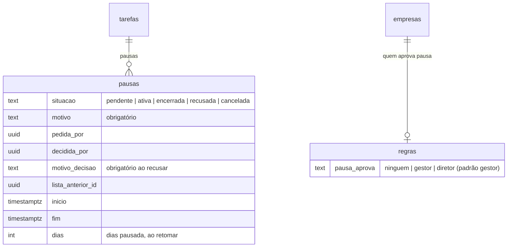

- **O prazo é o do cartão** e pausada não atrasa (`v_tarefas.atrasada`, `app.tarefas_atrasadas` e a rotina diária deixam de fora a lista de tipo `pausa`).
- **Pausar:** `fluxo.pausar(tarefa, motivo)`; entrar na lista Pausadas só por ela (o `t_lista` recusa o arraste direto). Quem tem o nível de `regras.pausa_aprova` (o próprio nível, ou administrador) pausa na hora; os demais deixam o pedido pendente, com o cartão na lista em que está, e o primeiro superior com o nível recebe `aprovacao_pendente` (origem `tarefa_pausas`). `fluxo.decidir_pausa(pausa, aprovar, motivo)`: aprovar move para Pausadas guardando a lista de antes; recusar exige motivo; quem pediu pode desistir. `fluxo.salvar_regra_pausa` pelo administrador.
- **Retomar:** `fluxo.retomar(tarefa)` encerra a pausa, volta à lista de antes (se ainda aberta) e empurra o prazo pelos dias pausados (corridos, ou úteis quando a empresa conta dias úteis); as sucessoras do cronograma andam em cascata. Concluir a tarefa direto da pausa encerra a pausa sem empurrar.
- **Tempo:** `fluxo.v_tarefa_sla` dá dias aberta, dias pausada, dias líquidos, número de pausas e se há pausa ativa ou pedida.
### Visibilidade por cartão (bloco 3)

Decisões do Moisés de 29/out/2026. Mesma migration.

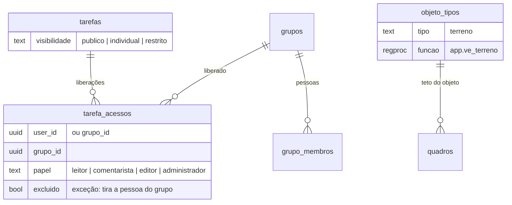

- **Teto do objeto:** `fluxo.ve_objeto` chama a função registrada para o tipo do quadro (no BKM, `app.ve_terreno`, hoje a empresa; os perfis de acesso a terrenos entram nela). Sem objeto ou tipo sem registro, o teto é a empresa. O administrador do sistema vê tudo.
- **Papel no cartão** (`fluxo.papel_cartao`, nulo = não vê): quem criou é administrador do cartão. Público: o papel do sistema (diretor, gestor e analista editam; leitura e básico leem), que um acesso dado no cartão pode subir. Individual: só quem criou. Restrito: o acesso dado (o da pessoa vale sobre o dos grupos; exceção anula o do grupo), senão editor para quem está no cartão e para o diretor.
- **RLS:** cartão e filhas (pessoas, etiquetas, checklists e itens, comentários e reações, anexos, vínculos, aprovações, pausas, linha de base) leem por `fluxo.papel_tarefa` e escrevem por `fluxo.edita_tarefa` (comentar: `fluxo.comenta_tarefa`); as funções da tarefa conferem `fluxo.exigir_edicao_tarefa`. O histórico (`app.auditoria`) esconde o que é de cartão que a pessoa não vê.
- **Regras:** a visibilidade só muda por quem gerencia (`fluxo.gerencia_tarefa`: administrador do cartão ou do sistema, ou diretor que vê o cartão); pôr outra pessoa num individual o torna restrito (gatilhos `t_visibilidade` e `t_restringe`); item que vira cartão herda a visibilidade e os acessos; modelo de tarefas guarda a visibilidade (restrito no modelo = só os envolvidos); salvar o quadro como modelo leva só o que quem salva vê.
- **@ no cartão:** `fluxo.papel_cartao` e `fluxo.papel_tarefa` aceitam a pessoa (padrão: quem lê), e a função do teto recebe (objeto, pessoa); `app.tg_mencoes` só avisa quem vê o cartão. A tela só oferece no @ quem vê o cartão.
- O banco tem `publico` como padrão para quem insere direto; a tela sempre pergunta.

### Campos personalizados (bloco 4)

Decisões do Moisés de 30/out/2026. Mesma migration.

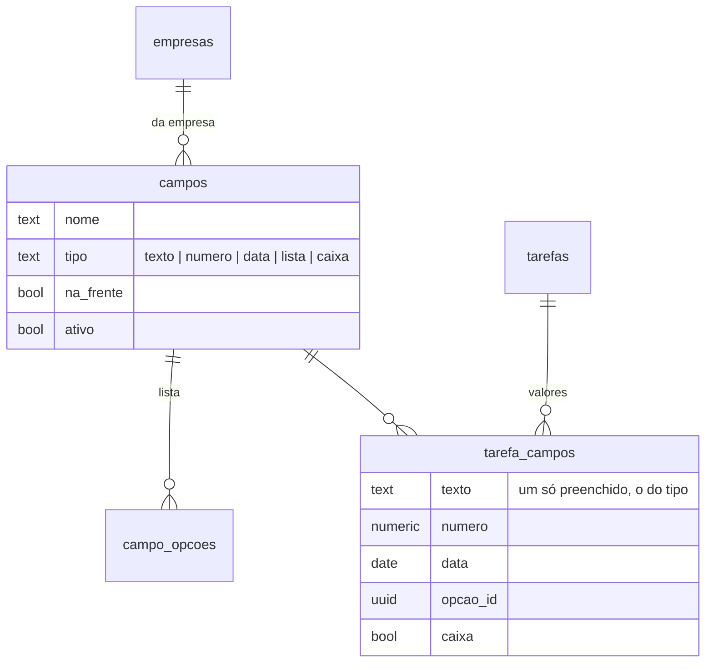

- Campos da empresa, para todos os quadros; o administrador cria e muda (RLS `app.eh_administrador`, com auditoria). Sem linha em `tarefa_campos`, o campo está "não informado"; sim/não guarda `false` para "não".
- `t_valor` confere o valor no tipo do campo, a opção do próprio campo e campo ativo; `t_guarda` impede mudar o tipo ou apagar campo e opção com valor (desativar). Valores seguem a visibilidade do cartão (`fluxo.papel_tarefa` / `fluxo.edita_tarefa`), e o histórico os esconde de quem não vê o cartão.
- "Obrigatório para concluir" saiu do campo (31/out/2026): o campo entra no cartão como item (`tarefa_itens`), e a regra em branco é de cada cartão (ver "Campos do terreno no cartão, regra em branco e condições" abaixo). Gravar valor inclui o campo no cartão sozinho (`tg_campo_incluido`).

### Recorrência (bloco 4)

Decisões do Moisés de 30/out/2026. Mesma migration.

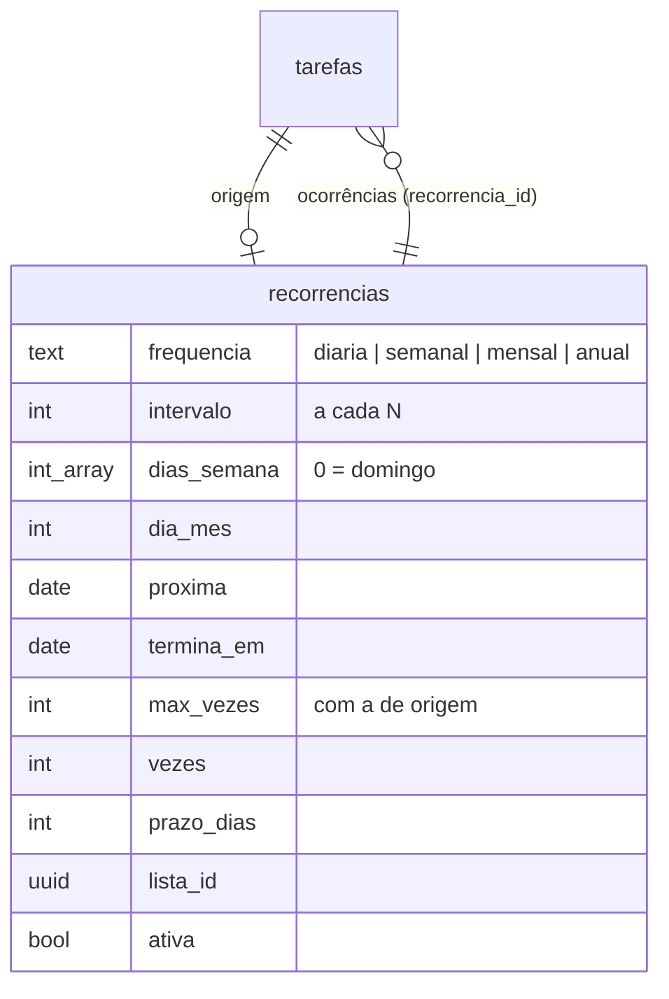

- O cartão de origem é o modelo e a primeira ocorrência. `fluxo.gerar_recorrencias(data)`, chamada por `app.rotina_diaria`, cria cada ocorrência na data agendada, mesmo com a anterior aberta: cópia do cartão de origem como ele está (pessoas, etiquetas, prioridade, visibilidade, acessos e checklists em aberto, com o prazo do item deslocado), início na data e prazo `prazo_dias` depois; campos personalizados não vão. Se a rotina falhar um dia, a data perdida nasce na volta.
- `t_valida` recusa série numa ocorrência, lista de outro quadro ou que não seja aberta; calcula o dia do mês e a próxima data (`fluxo.proxima_ocorrencia`: mês sem o dia usa o último; semanal a cada N semanas com os dias marcados). Na criação, ao retomar e ao mudar a regra (a partir da última ocorrência), data de hoje ou passada pula para amanhã em diante: nada nasce atrasado. A série encerra em `termina_em`, em `max_vezes` ou com o cartão de origem arquivado.
- RLS pelo cartão de origem (`fluxo.papel_tarefa` / `fluxo.edita_tarefa`); só a rotina executa a geração.

### Apontamento de horas (bloco 4)

Decisões do Moisés de 30/out/2026: sem aprovação, e por ora só no banco (o app ainda não tem a tela). Mesma migration.

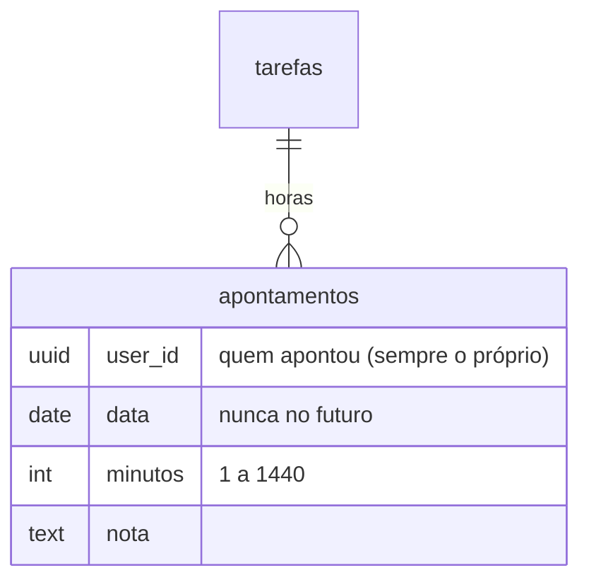

- `tarefas.estimativa_min` guarda a estimativa; `fluxo.v_tarefa_horas` soma o apontado, por pessoa (`por_pessoa`, jsonb) e no total.
- `t_valida` recusa data futura, mais de 24 h da mesma pessoa no mesmo dia e troca de pessoa. RLS: vê quem vê o cartão; aponta quem edita o cartão, só em nome próprio; muda e apaga o autor ou o administrador do sistema. Auditoria ligada, escondida de quem não vê o cartão.

### Copiar cartão e modelo de cartão (bloco 4)

- `fluxo.copiar_tarefa(tarefa, lista, título, itens)` roda com os direitos de quem copia (RLS de cada tabela): só copia o que a pessoa vê, para uma lista aberta de um quadro que ela vê e edita. `itens` escolhe o que vai: `checklists` (itens em aberto, sem prazo), `etiquetas`, `pessoas` (responsável, executores, aprovadores, quem acompanha e responsáveis dos itens), `campos` (só ativos e opções ativas), `anexos` e `automacoes` (as regras do cartão, por `fluxo._copiar_automacoes`, com quem copia como dono). Vão sempre a visibilidade, os acessos, a prioridade, a capa e a estimativa; nunca datas, comentários, horas, aprovações nem a série.
- `tarefas.modelo`: o cartão fica no quadro como base. Não conclui (`tg_tarefa_lista`), não atrasa (`v_tarefas`, rotina diária), não tem recorrência nem vem de uma (`t_modelo`). Criar a partir do modelo é copiar.

### Tarefas pelo funil (bloco 4)

- `app.v_tarefas_funil` (em `…000400_negociacao.sql`, porque junta `fluxo` com `app.processos`): cada tarefa de quadro de terreno com a fase aberta do terreno (ativa ou em stand by, sem as partes), a etapa e a subetapa; uma linha por fase aberta. Base da vista Funil da página Tarefas, só leitura (formato Monday: uma tabela por fase, etapa ou subetapa, uma linha por terreno; o andamento e a próxima tarefa saem das tarefas do terreno).

- **Fica para os próximos blocos:** WhatsApp e a tela de horas (botões e agendamentos vieram no 5b).

### Automações (bloco 5a)

Regras "quando acontecer X, se Y, faça Z" (decisão de 30/out/2026), no modelo do Butler do Trello. O esquema `fluxo` guarda a regra e o registro; o aviso sai por um gancho (`fluxo._avisar`) que o app troca pela notificação dele (`app._notificar`, tipo `automacao`, origem `automacao_execucoes`).

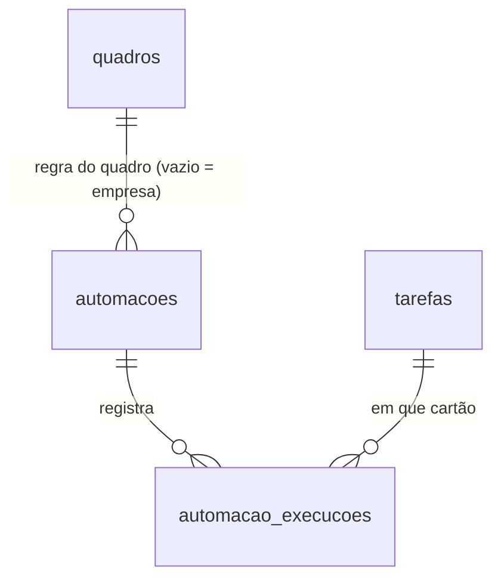

- `automacoes`: nome, escopo (`quadro_id` vazio = empresa toda, só administrador, listas pelo nome; com quadro, de quem edita o terreno, listas pelo id), `gatilho` (`criada`, `entrou_lista`, `concluida`, `etiqueta`, `campo`, `checklist_completo`, `prazo_antes` com `gatilho_dias`, `prazo_venceu`) e o parâmetro dele (lista, etiqueta ou campo; vazio = qualquer), `condicoes` e `acoes` em JSON (conferidos por `tg_automacao`), `ativa`, `dono_id`. Só o dono ou o administrador muda; com execuções não se apaga.
- **Regra do cartão** (30/out/2026): `automacoes.tarefa_id` prende a regra a um cartão (o `quadro_id` vem dele). Cria quem edita o cartão (`papel_tarefa` de Editor para cima); não usa o gatilho `criada`; o cartão não muda depois. Dispara só nele (`disparar_automacoes` e `automacoes_prazo` filtram por `tarefa_id`) e, na mesma ordem, roda depois das da empresa e das do quadro. `fluxo._copiar_automacoes(de, para, dono)` (definer) leva as regras na cópia do cartão e em cada ocorrência da recorrência, trocando as listas pelo nome quando o quadro muda e pulando a que não tem a lista lá; o dono que não edita o cartão novo fica de fora.
- `automacao_execucoes`: regra, cartão, gatilho, `referencia` (o prazo, nos gatilhos de prazo: único por regra e cartão), quem disparou (vazio = rotina), resultado `ok` ou `erro` e o resumo do que fez.
- Disparo: gatilhos `t_auto` no cartão, nas etiquetas, nos campos e nos itens de checklist chamam `fluxo.disparar_automacoes`; "criada" é um gatilho adiado para o fim da transação, e o cartão criado na mesma transação não dispara os outros (cópia, ocorrência e modelo nascem com tudo). Prazo: `fluxo.automacoes_prazo` na rotina diária.
- Regras de execução: a regra roda só se o dono ainda tem o direito (administrador ou editor) e, no quadro, vê o cartão; as ações rodam com `fluxo.automacao = '1'`, e nenhum gatilho dispara nesse estado (sem cadeia); erro numa ação desfaz só a regra e fica registrado; avisos só para quem vê o cartão.

### Botões e agendamentos (bloco 5b)

Dois gatilhos a mais em `fluxo.automacoes` (30/out/2026), com as mesmas condições, ações, escopos (empresa, quadro, cartão), dono e registro:

- `botao`: a regra vira um botão nos cartões que passam nas condições. `fluxo.botoes_cartao(tarefa)` lista os que valem para o cartão (ligados, do escopo, dono com direito e, no quadro, dono que vê o cartão); quem não edita o cartão recebe a lista vazia. `fluxo.apertar_botao(botao, tarefa)` confere de novo, roda as ações como numa regra (sem disparar outras) e devolve a execução, com quem apertou em `user_id`.
- `agenda`: `agenda_freq` (`diaria`, `semanal`, `mensal`) e `agenda_dias` (dias da semana, 0 = domingo, ou do mês, 1 a 31, sem repetição). `fluxo.agenda_hoje(freq, dias, dia)` diz se roda no dia; o dia do mês que o mês não tem roda no último dia. `fluxo.automacoes_agenda(dia)`, na rotina diária, roda cada regra do dia em cada cartão do escopo (fora modelo e arquivado) que passa nas condições, uma vez por dia (`referencia` = o dia). Regra agendada sem condição é recusada, para não tocar todos os cartões.
- Condição `situacao` (qualquer gatilho): `aberta`, `atrasada` (aberta, prazo antes de hoje e fora da lista de pausa) ou `concluida`; os valores marcados somam.

### Campos do terreno no cartão, regra em branco e condições (ligação funil × quadros, lote A)

Decisões do Moisés de 31/out/2026 (simulação "Funil e quadros"). Banco em `…000150_fluxo.sql` (itens, justificativas, pendências) e `…001200_campos.sql` (catálogo e funções do app).

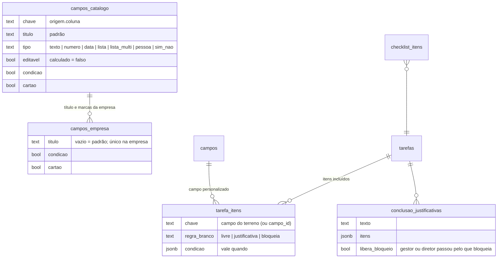

- `app.campos_catalogo`: um campo por linha, de Terreno, Negociação, Oferta de referência, Proposta vigente e Calculado (forma de pagamento vigente = a da proposta vigente, senão a da oferta; margem e VGV do estudo válido; preço por m²; zonas; vários donos; corretores). `app.campos_empresa` guarda o que o administrador muda (Configurações › Campos, `app.salvar_campo`): o **título** (o nome que o usuário vê, editável a qualquer hora, sem repetir na empresa) e as marcas **Condição** (aparece no "Vale quando") e **No cartão** (pode entrar no cartão). `app.v_campos` junta os dois.
- O esquema `fluxo` não conhece terreno: lê os campos pelas funções registradas em `fluxo.objeto_tipos` (`campo_objeto` = `app.campo_cartao`, `avalia_condicao` = `app.avaliar_condicao`, `valida_condicao` = `app.validar_condicao`). Em branco é nulo, vazio, lista vazia ou o "não informado" da coluna; em branco só satisfaz "não informado".
- **No cartão:** quem edita o cartão inclui itens pelo bloco Formulário (antes "+ Campo"; ver "Formulário da tarefa e máscaras") (`tarefa_itens`): campos do terreno ou da negociação marcados "No cartão" e campos personalizados; o checklist já é item. O campo do terreno aparece com o controle do tipo e grava no próprio terreno (`app.gravar_campo`: ficha por `app.salvar_terreno` com a versão atual, oferta direto, temperatura por `app.definir_temperatura`); calculados só leem.
- **Regra se em branco**, de cada item e local da tarefa: pode concluir (padrão), conclui com justificativa, não conclui. Vale para campos do terreno, campos personalizados e cada item de checklist (`checklist_itens.regra_branco`; vazio = regra da empresa para checklist). "Não conclui" trava o analista; gestor e diretor concluem com justificativa, como no funil (`libera_bloqueio`). A justificativa é pedida na hora (`fluxo.concluir_justificando`, que conclui ou pede a aprovação) e fica no histórico.
- **Vale quando** (`condicao` jsonb): `{"modo": "todas" | "qualquer", "itens": [{"campo", "op", "valores"} | {"grupo": {...}}]}`, com um nível de grupo ("(A ou B) e C"). Operadores pelo tipo (é / não é, igual, maior, menor, entre, antes, depois, nos últimos N dias, sim, não, preenchido, não informado). Condição que deixa de valer tira a pendência ("não se aplica mais"); a tarefa fica.
- **Aba Configuração** do cartão: só diretor, administrador e quem criou a tarefa (`fluxo.configura_tarefa`) veem e mudam regra e condição (o trigger `fluxo.tg_tarefa_item` recusa os demais e também tirar do cartão um item com regra); os outros veem só o selo ("necessário", "pede justificativa").
- `fluxo.itens_em_branco(tarefa)` lista o que está em branco com regra e condição valendo; `fluxo.pendencias_conclusao` devolve `'checklist'` e `'campos'` (bloqueiam, salvo justificativa do diretor) e `'justificar'` (conclui com justificativa).
- Itens, regras e condições vão na cópia do cartão (escolha "Campos"), na recorrência e no modelo de tarefas (`modelo_tarefas.itens`; item de checklist do modelo pode ser `{texto, regra, condicao}`).

### Formulário da tarefa e máscaras (1/nov/2026)

Decisões do Moisés de 1/nov/2026 (simulação "Formulário da tarefa"). Banco em `…000150_fluxo.sql` e `…001200_campos.sql`.

- **Formulário:** os itens de `fluxo.tarefa_itens` viram perguntas. Cada uma tem `pergunta` (vazia usa o título do campo), `ajuda` opcional e grava num de três destinos: campo do terreno marcado No cartão (`chave`), campo personalizado (`campo_id`) ou **Só no cartão** (`tipo`, com a resposta em `resposta jsonb`; `num_nonnulls(chave, campo_id, tipo) = 1`). Tipos do "só no cartão": texto, parágrafo, número, moeda, percentual, data, sim/não, lista (`opcoes text[]`, ao menos 2), e-mail, telefone, CPF e CNPJ. Pergunta "só no cartão" exige o texto da pergunta; com resposta, o tipo não muda.
- **Forma de responder** (`forma`; nula = a primeira da lista): `fluxo.formas(tipo, n_opcoes)` diz as permitidas. Lista: menu, radio, chips; segmentado até 4 opções; chave só com 2; mais de 6 opções, só menu. Sim/não: botões ou chave. Texto: linha ou parágrafo. Os demais têm uma só. O trigger recusa forma fora da lista.
- A **chave** tem três estados: começa no meio (não informado), os toques alternam Sim e Não, e "Limpar resposta" (menu ⋮) volta ao meio. Vazio nunca vira "não".
- Quem edita o cartão monta as perguntas (modo Montar: incluir, editar, subir, arrastar, tirar; tirar item com regra segue a aba Configuração); Leitura só vê. Sem seções nem saltos por ora: pergunta condicional usa o "Vale quando".
- `fluxo.itens_em_branco` conta a pergunta só no cartão sem resposta (tipo `pergunta`). Pergunta, ajuda, forma, tipo, opções e regra vão na cópia (a resposta só quando se copiam os campos), na recorrência, no modelo de tarefas e nas tarefas da etapa.
- **Máscaras** (`formato`): e-mail, telefone, CPF e CNPJ em texto; moeda e percentual em número; CEP no catálogo. Gravadas só com os dígitos (e-mail em minúsculas) por `fluxo.validar_formato(formato, valor)`, que confere DDD, dígitos verificadores de CPF e CNPJ e o formato do e-mail; `fluxo._formato_ok` faz a mesma conta sem erro. No campo do terreno, a máscara vem do catálogo (`app.campos_catalogo.formato`, fixa) ou, nos campos de texto sem máscara fixa, do administrador em Configurações › Campos (`app.campos_empresa.formato`, `app.salvar_campo(..., p_formato)`: nulo mantém, vazio tira; recusa se algum terreno tem valor fora da máscara); `app.gravar_campo` normaliza. No campo personalizado, `fluxo.campos.formato` (não muda com valor fora da máscara). Na pergunta só no cartão, o tipo já é a máscara.
- **Criação rápida:** Nova tarefa abre curta (título, terreno, que vem marcado quando se cria dentro da ficha, responsável (digitado com @, com busca aproximada pelo nome e pelo @; vem quem cria), prazo com atalhos 1 dia, 1 semana e 1 mês ou a data digitada (mesmo dia do mês seguinte, ou o último dia), etapa e subetapa, descrição atrás de "Adicionar descrição" e visibilidade); "Mais opções" abre a janela completa com o que já foi digitado. A tarefa nasce na lista Fazer (ou na primeira), com prioridade média. Etapa e subetapa vêm com as atuais do terreno (`app.tg_tarefa_processo` grava `etapa` e `subetapa` do processo aberto da fase mais adiante quando a tarefa chega sem elas) e trocam no seletor, entre as fases abertas; "Nenhuma" deixa sem etapa. No cartão, a subetapa também tem seletor (menos na tarefa que nasceu de regra da etapa). A subetapa da tarefa à mão é informação: a trava continua pela regra da etapa.

### Tarefas da etapa, trava e volta de etapa (ligação funil × quadros, lote B)

Decisões do Moisés de 31/out/2026 (simulação "Funil e quadros"). Banco em `…001300_funil_tarefas.sql`, com os ganchos em `…000500_regras.sql` (passagem, encerrar, retomar, pendências), `…000400_negociacao.sql` (etapa do cartão), `…000150_fluxo.sql` (condição na tarefa do modelo, pausa de fora, gatilho) e `…000200_cadastros.sql` (condição no checklist e no pré-requisito).

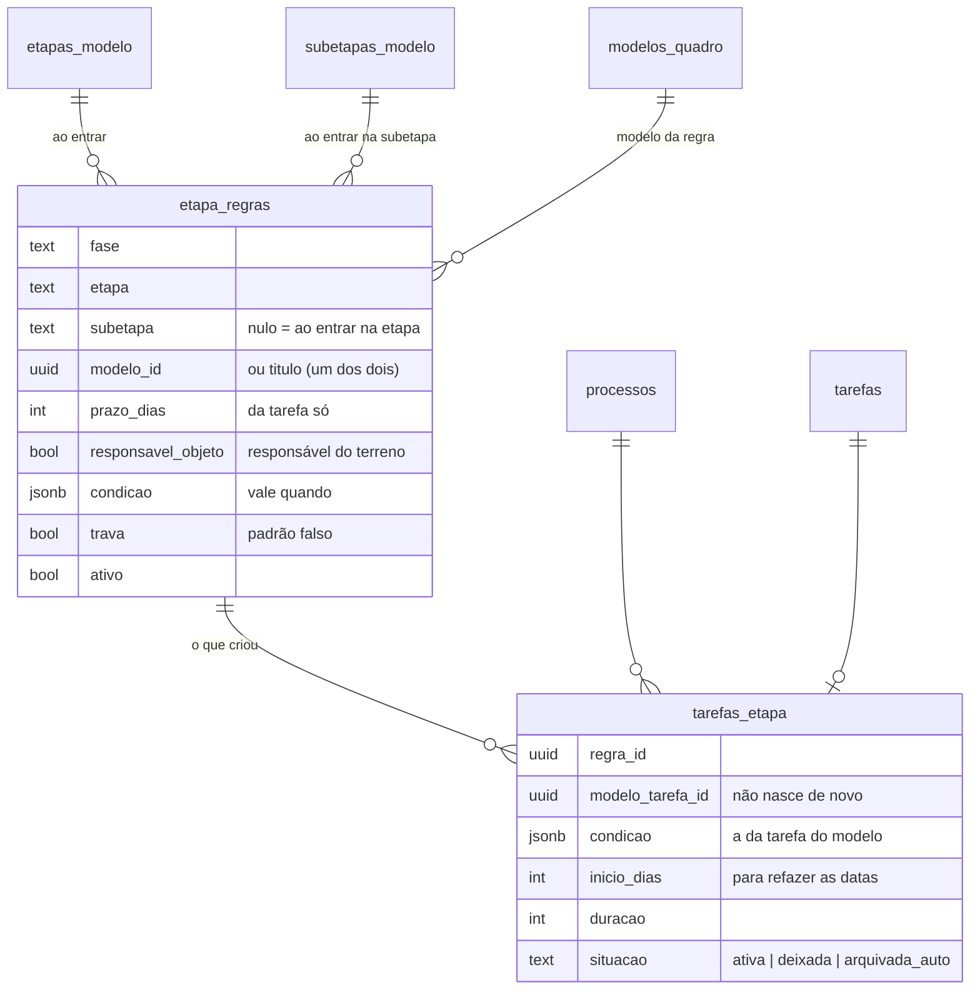

- **Etapa do cartão:** `fluxo.tarefas.processo_id`, `etapa` e `subetapa`. A tarefa nova sem etapa nasce na etapa atual do terreno (o processo aberto da fase mais adiante, ativo antes do stand by; `app.tg_tarefa_processo`); `etapa = 'nenhuma'` tira. Mudar a etapa à mão limpa a subetapa de outra etapa.
- **Regras** (`app.etapa_regras`, Configurações › Funil › Tarefas da etapa, só administrador): `app.salvar_regra_etapa` valida etapa, subetapa da etapa, modelo da empresa ou título e condição; `app.apagar_regra_etapa` apaga a que não criou tarefa e desativa a que criou.
- **Entrar** (`app._tarefas_ao_entrar`, ao abrir o processo, ao mudar de etapa e de subetapa): primeiro devolve as `arquivada_auto` daquela etapa (mesmo código; datas refeitas por `inicio_dias` e `duracao` a partir de hoje, ou deslocadas pelos dias arquivadas) e reativa as `deixada`; depois aplica as regras cuja condição vale. Modelo por `fluxo.aplicar_modelo_mapa`, pulando as tarefas do modelo já criadas neste processo (as predecessoras se ligam às existentes) e as tarefas do modelo cuja condição não vale; tarefa só uma vez por processo. Ao entrar na etapa, dispara o gatilho `etapa` (`'fase:etapa'`) nos cartões abertos dela.
- **Trava** (`app._trava_tarefa`): a tarefa da regra que ainda bate com a etapa e a subetapa dela trava no nível da regra (`etapa` ou `subetapa`) se a regra trava; condição da regra ou da tarefa do modelo que não vale = `nao_se_aplica` (não trava). Tarefa à mão, ou que mudou de etapa, trava no nível `etapa` quando a etapa tem regra da etapa que trava. `deixada` e `arquivada_auto` não travam. `app._tarefas_travando(processo, saida)` vira item de pendência (`tipo 'tarefa'`, código, lista, atrasada; título "restrita" para quem não vê o cartão), somado em `app._pendencias` ao sair da etapa para frente ou concluir a fase (nível etapa e a subetapa atual) e ao sair da subetapa para frente (nível subetapa). Gestor e diretor passam com justificativa, como nas outras pendências.
- **Pode avançar** (`t_pode_avancar`): concluída a tarefa que travava, se nada mais trava naquele nível, `pode_avancar` vai para o responsável do terreno ("TER-x pode avançar. As tarefas de … estão concluídas."). Nunca move o processo.
- **Voltar** (`app._tarefas_ao_voltar`): abertas das etapas depois do destino; sem trabalho (`app._tarefa_tem_trabalho`: comentário, anexo, item marcado, subtarefa, campo personalizado, troca de lista na auditoria) arquivam (`arquivada_auto`); com trabalho ficam `deixada` e o responsável recebe `etapa_deixada`.
- **Encerrar e retomar** (`app._tarefas_ao_encerrar`, `app._tarefas_ao_retomar`): Stand By pausa as abertas do processo sem pedido (`fluxo._pausar_de_fora`, `pausas.origem = 'stand_by'`, que só a retomada da fase encerra, empurrando o prazo); Perdido e Descartado arquivam (fechando a pausa ativa), salvo `dados.tarefas = 'manter'`; concluir não mexe.
- **Condição** no checklist (`checklist_modelo.condicao`, `app.condicao_checklist`) e no pré-requisito (`prerequisitos_modelo.condicao`, `app.condicao_prerequisito`): o documento ou a passagem só é exigido quando a condição vale (`app.condicao_aplica` em `v_checklist` e em `app._pendencias`).
- `app.v_tarefas_etapa`: cartão, fase, etapa, subetapa, regra, nível da trava e situação, para a tela.

### Jornada do terreno (1/nov/2026)

Decisões do Moisés de 1/nov/2026 (simulação https://claude.ai/artifact/9eocQHsh2rDz8BtDak6d8D). Banco em `…001400_jornada.sql`, com os campos novos do terreno em `…001200_campos.sql` e a regra do checklist e do pré-requisito em `…000200_cadastros.sql` e `…000500_regras.sql`. A tela (Configurações › Funil › Jornada) junta num lugar o que antes eram três abas; no banco, documentos, pré-requisitos e tarefas da etapa continuam nas tabelas deles, cada um com a sua regra.

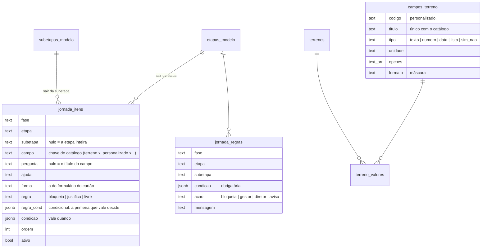

- **Fonte única:** a pergunta grava no campo que escolhe (`campo`), o mesmo que a ficha e o cartão gravam (`app.gravar_campo`, com o controle do tipo e a auditoria). O que não existe na ficha vira **campo novo do terreno** (`app.campos_terreno`, valor em `app.terreno_valores`), que entra no catálogo como `personalizado.<codigo>` (`app.campo_def`, `app.v_campos`, `app._valor_campo`) e por isso vale nas condições, no cartão e em Configurações › Campos. `app.salvar_campo_terreno` (administrador; título único com o catálogo; tipo não muda com valor gravado; opção em uso não sai) e `app.apagar_campo_terreno` (com valor ou na jornada, desativa).
- **Regra em branco** (as 3 opções em todo item): `jornada_itens.regra`, `checklist_modelo.regra` (`obrigatorio` virou coluna gerada `regra <> 'livre' or regra_cond is not null`), `prerequisitos_modelo.regra` (`app.regra_prerequisito`) e `etapa_regras.regra` (tarefa aberta ao sair; `trava` passou a ser "pode travar" = `regra <> 'livre'` ou com condicional, mantido por `app.salvar_regra_etapa`; só `trava` vira bloqueia ou livre), todos com bloqueia, justifica ou livre. **Comportamento condicional** (`regra_cond`, `[{condicao, regra}]`, validado por `app._regra_cond_config`): `app._regra_branco(terreno, regra, regra_cond)` devolve a regra da primeira condição que vale, ou a única; livre não entra nas pendências, justifica entra com `justifica`. Na tarefa à mão vale a regra mais forte das regras da etapa. Em `salvar_checklist` e `regra_prerequisito`, `p_regra_cond` nulo mantém e `'[]'` tira. Em `app._passagem`, se todo item que falta é `justifica`, qualquer editor passa com `p_forcar` e comentário; senão só gestor e diretor forçam, como antes. `app.checar_passagem` devolve `pode_justificar`.
- **Onde vale** (`app._jornada_na_saida`): item da etapa ao sair dela para frente ou concluir a fase; item da subetapa ao sair dela para frente (também pulando) e ao sair da etapa; voltar não pede nada. `app._jornada_pendencias` entra em `app._pendencias` (item com condição que não vale fica de fora; o item conta como feito quando o campo tem valor). A jornada é do terreno: a negociação de uma parte não a tem.
- **Regras pelo valor** (`app.jornada_regras`): condição que vale na saída → `bloqueia` vira pendência (gestor e diretor passam com justificativa, como nas outras), `gestor` e `diretor` entram nas aprovações exigidas (`app._jornada_pede` em `app._aprovacoes_exigidas`), `avisa` só mostra a mensagem.
- `app.jornada_processo(processo)`: os itens com `aplica` e `valor` e as regras que valem, para o quadro de avanço. Configuração: `app.salvar_item_jornada` (lugar válido, forma do tipo do campo, condição), `app.apagar_item_jornada`, `app.salvar_regra_jornada`, `app.apagar_regra_jornada`, todas só do administrador e com auditoria.
- Atualização em tempo real entre usuários fica para o porte do front (Supabase realtime); o banco já tem uma fonte só.

## Setores censitários e renda familiar estimada

Camadas do mapa (renda familiar estimada e densidade demográfica bruta, uma de cada vez) e quadro "Renda e população do entorno" da ficha (decisão do Moisés, 24/out/2026). Dados do IBGE, Censo 2022, hoje de São Paulo e São José dos Campos (uma carga por município, mesma metodologia, faixas e cores), carregados por `tools/setores/gerar.py` (malha oficial, agregados de renda do responsável e composição oficial setor → área de ponderação); nada é estimado na carga. Tabelas comuns a todas as empresas, só leitura para o front.

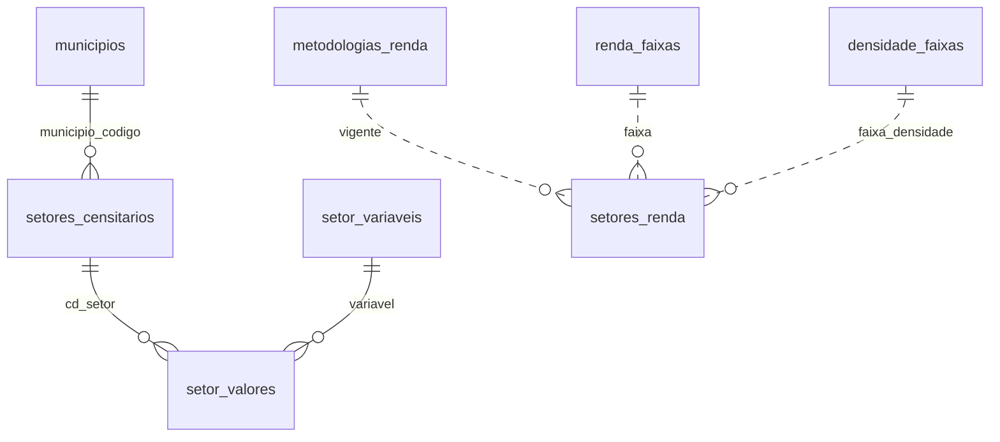

| Tabela / função | O que guarda |
|---|---|
| `setores_censitarios` | setor (15 dígitos), município (calculado), área de ponderação oficial, distrito, área e polígono do IBGE (`geom`, 4326) |
| `setor_variaveis` | catálogo das variáveis guardadas (V0001 pessoas, V0007 domicílios, V06001, V06002, V06004, V06006 e as 50 do perfil: demografia V01007–V01041, domicílio V00001–V00052, básico V0008 e V0009) |
| `setor_valores` | valor de cada variável por setor como o IBGE publicou; sigilo (`X`) e sem valor (`.`) ficam nulos com a `situacao`, nunca zero |
| `metodologias_renda` | versões da metodologia; uma `vigente`: fator familiar (1,6, decisão do Moisés), PNAD base e atual (`fator_pnad` calculado) |
| `renda_faixas` | as 16 faixas fixas e suas cores (decisão de produto; o limite de cima entra na faixa, depois de arredondar para reais) |
| `densidade_faixas` | as 10 faixas fixas da densidade bruta (hab/km²) e suas cores; a 0 é "sem moradores" (zero de verdade); o limite de cima entra, sem arredondar |
| `setores_renda` (view) | por setor: V06004 original, renda familiar estimada 2022 e atual, faixa, média distorcida (média acima de 3 × a mediana), densidade bruta (pessoas ÷ `area_km2`) e a faixa dela |
| `estatisticas_area(geom)`, `estatisticas_raio(lat, lng, m)`, `estatisticas_terreno(id, raio)` | população, domicílios, densidade, renda média ponderada pelos responsáveis com rendimento e distribuição por faixa; cada setor entra pela fração da área dentro do recorte |
| `demografia_grupos` | grupos do perfil da população: idade (8 grupos por soma exata das variáveis do IBGE, total, homens e mulheres), domicílios por número de moradores e por espécie |
| `setor_soma(setor, vars)`, `perfil_area(geom)`, `perfil_terreno(id, raio)` | perfil do entorno: pessoas, domicílios, moradores por domicílio ocupado, sexo, idade, tamanho e espécie dos domicílios, vagos e uso ocasional; um grupo só entra num setor com todas as variáveis divulgadas, e o resto sai como "não divulgado" |
| `setores_no_retangulo(...)` | setores da tela, simplificados pelo zoom, para o mapa, com a faixa de renda e a de densidade |

Fonte única da metodologia, faixas e cores: `tools/setores/metodologia_renda.json` (renda) e `tools/setores/metodologia_densidade.json` (densidade); o teste do banco confere que a migration tem os mesmos valores.

## Concorrência

Empreendimentos de outras empresas, marcados no mapa (decisão do Moisés, 24/out/2026). Cadastro sem regra de funil: escrita direta pelo front (Leitura só vê), com auditoria e isolamento por `empresa_id`.

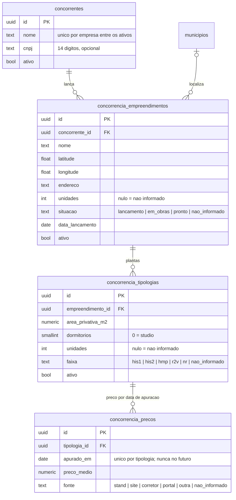

- **Preço nunca é sobrescrito:** cada data de apuração é uma linha nova em `concorrencia_precos`; lançar de novo na mesma data corrige aquele valor. Um preço lançado errado pode ser apagado (fica na auditoria); empresa, empreendimento e tipologia são desativados.
- **Preço médio é o da unidade**, digitado pelo usuário; o sistema não distingue tabela de promoção. Não há preço por m² informado.
- **Preço por m² do empreendimento é calculado** (`app.concorrencia_resumo(data)`), com o último preço de cada tipologia ativa até a data: com as unidades de todas as tipologias precificadas, média ponderada pelo mix (soma de preço × unidades ÷ soma de área × unidades); faltando alguma, média simples do preço por m² das tipologias (`mix_completo = false`). Devolve também o período dos preços usados (`apurado_de`, `apurado_ate`) e as faixas.
- **Faixa social na tipologia**, não no empreendimento, porque um empreendimento mistura HIS, HMP e R2V.
- `v_concorrencia`: empreendimentos ativos com a empresa e o resumo de hoje; é o que o mapa e o quadro leem. `app.concorrencia_tipologias_em(data)`: cada tipologia com o preço vigente na data.
- Estoque e velocidade de vendas ficaram de fora (decisão do Moisés). A concorrência perto do terreno na ficha e uma página de lista ficam para depois.

## Estudo de viabilidade estática

Decisões do Moisés, 25 e 26/out/2026. Avaliação prévia do terreno, **sem fluxo de caixa**. Migration `20261015001000_viabilidade.sql`; protótipo em `tools/prototipo/proto_viab.js`.

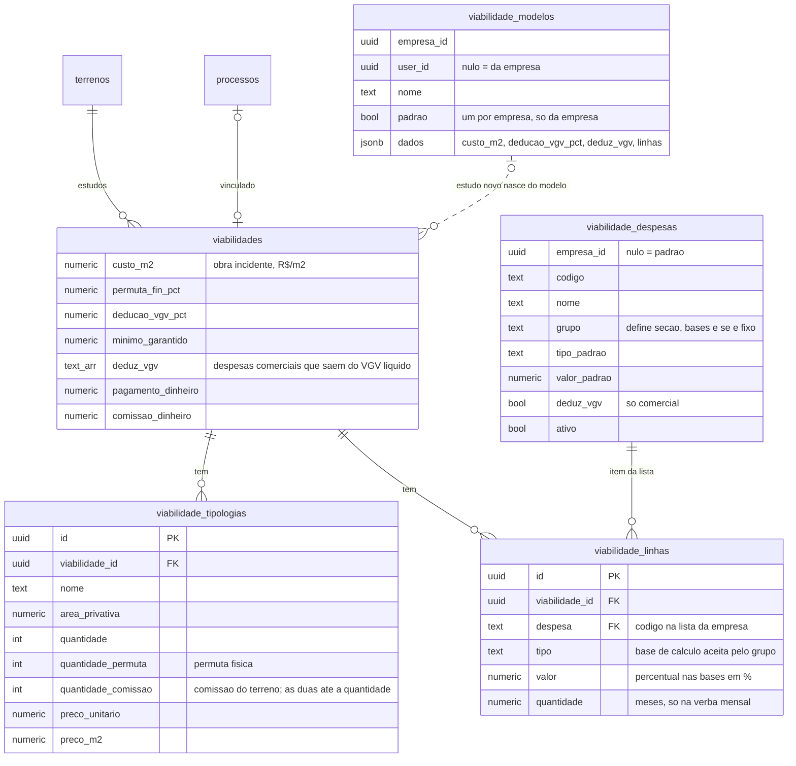

- O estudo é do terreno (vários por terreno; `app.viabilidades` com `tipo = 'estatica'`). A negociação vincula um (`app.vincular_estudo`, só na fase de entrada e do mesmo terreno); o estudo externo do BKM (`tipo = 'externa'`, `app.vincular_viabilidade`) continua. Criar e duplicar por `app.criar_viabilidade` (já com os itens fixos), nome e os dados digitados da obra e do terreno por `app.salvar_viabilidade`, apagar por `app.apagar_viabilidade` (vinculado ou usado em proposta não se apaga). Tipologias e linhas são escrita direta (sem regra de funil), com auditoria; o trigger recusa base que o grupo não aceita e item fixo repetido. Rentabilidade mínima da empresa em `app.viabilidade_config.margem_minima_pct` (só o administrador, por `app.salvar_margem_minima`; nulo = sem mínima): `v_terrenos.abaixo_margem_min` acende quando a margem do estudo válido fica abaixo dela (substitui o antigo preço máximo do terreno, que saiu de `app.viabilidades` em 26/out/2026).
- **Preços ligados** (trigger `t_precos`): com a área, mudar o preço unitário refaz o m² e mudar o m² refaz o unitário; mudar a área refaz o m² quando há os dois preços e completa o que falta quando há um só.
- **Grupos** (`app.viab_tipos`, `app.viab_secao`, `app.viab_fixo`, iguais a `grupos` em `despesas.json`): Custo de obras › Custo de obra atípico, Custo de obra não incidente, Custo de projetos, Custo pós-obra (na tela, quadros com o total no título e seta de abrir e fechar; o atípico fica dentro do quadro Custo de obra incidente, junto do típico; decisão do Moisés de 28/out/2026); Despesas gerais › Terreno, Incorporação, CEF, Administrativo e financeiro; Taxas (fixos); Despesas financeiras (fixos: Custo de alavancagem, Custo de juros PJ em % da obra total, Custo financeiro, Impostos; depois do EBITDA, decisão do Moisés de 26/out/2026), mais dois grupos de um item cada na mesma seção, Custo de capital permuta financeira (`capital_permuta`) e Custo de capital pagamento terreno (`capital_pagamento`), com uma base só, o Aporte em % (`pct_aporte_permuta` = permuta financeira em dinheiro, com o mínimo garantido quando ele vale; `pct_aporte_pagamento` = pagamento em dinheiro do terreno; decisão do Moisés de 28/out/2026). Taxas e Despesas financeiras (`app.viab_restrito`) nascem com o valor padrão da empresa e só a diretoria ou o administrador (`app.eh_diretoria`) muda ou tira a linha do estudo; `criar_viabilidade` liga `app.viab_criando` para copiar; Despesas comerciais (fixos). Itens fixos aparecem sempre no estudo, sem incluir nem tirar.
- **Cálculo** (`app.calcular_viabilidade`, o mesmo do protótipo; os totais ficam no cabeçalho, refeitos por trigger):
  - VGV = Σ quantidade × preço unitário. **VGV vendido** = VGV − unidades em permuta física − unidades da comissão; é o "VGV" das bases % do VGV. Unidades líquidas = unidades − permuta − comissão (base da verba por unidade).
  - **VGV líquido** = VGV vendido − % de dedução × VGV vendido − as despesas comerciais marcadas para deduzir (só as que a lista marca como dedutíveis: ITBI e registro de unidades vendidas, Produto Caixa).
  - **Custo de obras** em camadas: incidente (típico) = valor unitário × área privativa total; atípicos (área privativa, % do típico, % do VGV, verba); **raso** = incidente + atípicos; não incidente (+ % do raso); **obra total** = raso + não incidente; projetos e pós-obra (+ % da obra total). A seção soma tudo.
  - **Custo do terreno**: permuta física e comissão em unidades só informam (quantidade, área, %), porque já saíram do VGV vendido; permuta financeira = % × VGV líquido, nunca abaixo do mínimo garantido; + pagamento em dinheiro + comissão em dinheiro.
  - Despesas gerais, Taxas e Despesas financeiras: % do VGV, % da obra total, % do lucro líquido ou verba. O % do lucro é circular: lucro = L0 ÷ (1 + Σ%), com L0 o lucro antes desses itens; sem lucro, valem zero.
  - Despesas comerciais: % do VGV, verba total, verba por unidade (× unidades líquidas) ou verba mensal (× meses).
  - **EBITDA** = VGV líquido − obras − terreno − despesas gerais − despesas comerciais não deduzidas; **resultado sem as taxas** = EBITDA − despesas financeiras; **lucro líquido** = resultado sem as taxas − taxas (as taxas saem por último; `ebitda`, `despesas_financeiras`, `lucro_sem_taxas`); **margem líquida** = lucro ÷ VGV líquido. `despesas_total` soma todas as saídas, inclusive as deduzidas.
- **Modelos de estudo** (`app.viabilidade_modelos`, decisão do Moisés de 26/out/2026): valores e bases de cálculo guardados para o estudo novo nascer com eles. `app.salvar_modelo_viabilidade(estudo, nome, da_empresa, modelo)` grava o estudo como modelo novo ou por cima de um existente: guarda o valor unitário da obra, a dedução do VGV, as despesas que saem do VGV líquido e as linhas (item, base, valor, meses); tipologias, permuta financeira, mínimo garantido e pagamento e comissão em dinheiro são do terreno e ficam fora. Modelo da empresa (`user_id` nulo) só o administrador grava e apaga, e um deles pode ser o padrão (`app.marcar_modelo_padrao`); o do usuário só ele vê, usa e apaga (`app.apagar_modelo_viabilidade`). Taxas e Despesas financeiras só entram no modelo gravado pela diretoria e só se aplicam de modelo da empresa ou para quem é da diretoria; senão, ficam os valores padrão da lista. `criar_viabilidade(terreno, nome, copiar_de, modelo, sem_modelo)`: sem cópia nem modelo escolhido, usa o padrão da empresa (`sem_modelo = true`: só a lista); do modelo entram só itens ativos, com base ainda aceita pelo grupo, e só o que ainda é dedutível; os itens fixos que faltarem vêm da lista.
- Lista de itens da empresa: configuração do administrador (`app.salvar_despesa_viabilidade`, `app.apagar_despesa_viabilidade`; usado só desativa e não muda de grupo), copiada para cada empresa nova. Padrão em `tools/viabilidade/despesas.json` (o protótipo e o teste do banco leem).
- Leituras a confirmar com o Moisés: custo de obra típico = incidente; a dedução em % também sai do lucro (é custo, não só base da permuta); % do VGV sobre o VGV vendido.

## 3. Documentos

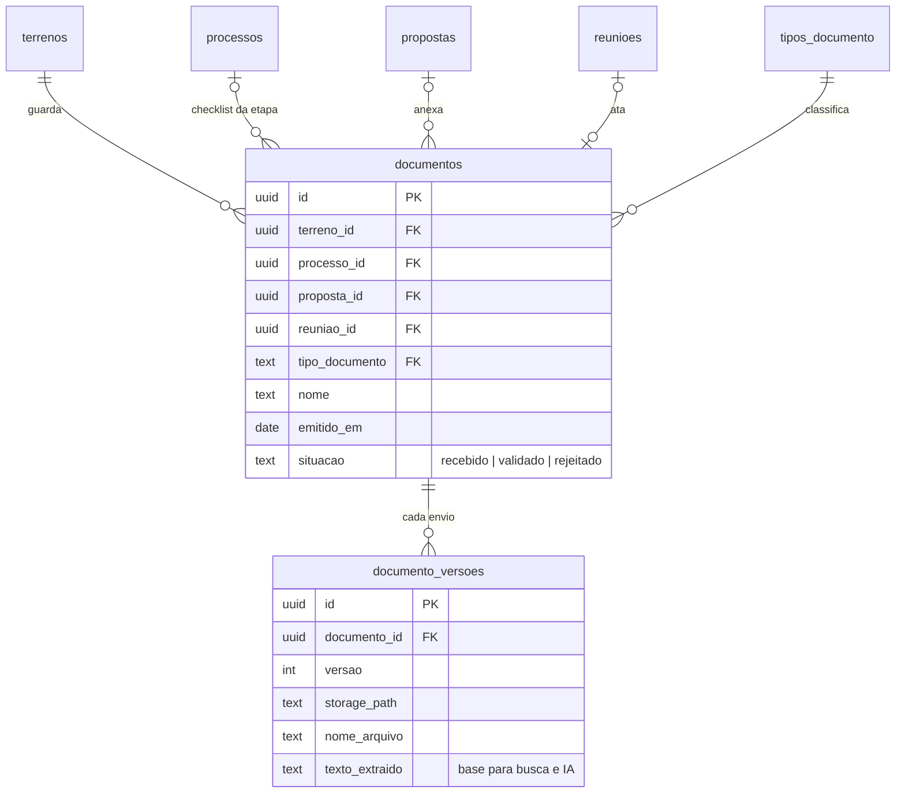

## Regras que o modelo garante

| Regra | Onde |
| --- | --- |
| "Não informado" é null ou `nao_informado`, nunca zero ou "não" | defaults e checks de `terrenos`, `terreno_infraestrutura` |
| Área adotada sempre com a fonte | check em `terrenos` |
| Área da poligonal calculada pelo desenho (m² inteiros); com a fonte `poligonal`, a adotada acompanha cada ajuste (pedido do Moisés, 24/out/2026) | coluna gerada `area_poligonal_m2` e trigger `t_norm` em `terrenos` |
| Parâmetros urbanísticos vêm do catálogo da empresa por zona e tipo de empreendimento; exceção do lote só com a fonte; gabarito "sem limite" é booleano e nunca leva valor; CA nunca é zero | checks em `zona_parametros` e `analise_zoneamentos` |
| Zonas da análise por lote: a consulta de um lote troca só as zonas dele | `app._substituir_zonas` |
| Catálogo de parâmetros só muda pelo administrador, com fonte e auditoria | `app.salvar_zona_parametro` |
| Uma análise urbanística vigente por terreno; anteriores preservadas | índice único parcial + trigger |
| Valor venal e IPTU por inscrição e exercício; correção vira nova revisão, a anterior fica preservada | `inscricao_valores` + trigger |
| Consulta do lote na base da prefeitura (GeoSampa, GeoSanja) só pela RPC, conferindo que o lote é o da inscrição e que o terreno é da cidade da base; nunca alterada; completa só campos vazios | `app.registrar_consulta_lote` |
| Inscrição escolhida numa cidade só entra em terreno dessa cidade | trigger `tg_inscricao_municipio` |
| Isento não tem IPTU; venal do imóvel = terreno + construção quando os dois existem | checks em `inscricao_valores` |
| Edição simultânea: salvar com versão antiga é recusado | `terrenos.versao` + `salvar_terreno` |
| Participações dos proprietários somam no máximo 100% (em cada parte) | trigger em `terreno_pessoas` |
| Matrícula, inscrição, pessoa e oferta só se ligam a parte ativa do mesmo terreno | triggers `tg_parte_do_terreno`, `tg_oferta_parte` |
| Terreno de vários donos só fica Comprado com todas as partes ativas compradas; negociação dividida não se move à mão | `_pendencias`, `_conferir_movimento`, `_sincronizar_principal` |
| Parte ativa sem negociação conta como pendência (nunca como ok); retomar o terreno abre a negociação da parte cadastrada no Stand By (2/nov/2026) | `_pendencias`, `retomar_processo` |
| A parte que sai da etapa responde pela Jornada do terreno (perguntas, regras pelo valor e tarefas que travam, que ficam no processo do terreno); quando as partes movem o terreno, as tarefas da etapa nascem e se arquivam como numa passagem à mão (2/nov/2026) | `_jornada_pendencias`, `_jornada_pede`, `_tarefas_travando`, `_sincronizar_principal` |
| Tarefa que trava o avanço: tirar a etapa (Nenhuma ou outro processo), arquivar ou virar modelo só com gestor ou diretor (2/nov/2026) | trigger `t_trava` em `fluxo.tarefas` |
| Aprovadores do cartão só mudam por quem gerencia o cartão e nunca com pedido aberto; quem criou, código, série, quem concluiu e quem arquivou não mudam pela tela (2/nov/2026) | triggers `t_aprovadores` em `fluxo.tarefa_pessoas` e `t_controle` em `fluxo.tarefas` |
| Lembrete e aviso de cartão (também o de pedido e decisão de aprovação e de pausa) só para quem vê o cartão (2/nov/2026) | RLS de `lembretes`, `tg_lembrete_valido`, `_notificar` |
| Fora da diretoria, as linhas de Taxas e Despesas financeiras não aparecem (nem o log delas): só o total do estudo; o cálculo conta todas. Trocar a linha de item também é mudá-la. Os modelos de estudo só se leem por `modelos_viabilidade`, sem essas linhas fora da diretoria, e o log do modelo é só da diretoria (2/nov/2026) | RLS de `viabilidade_linhas` e `auditoria`, `viab_linha_visivel`, `calcular_viabilidade`, `tg_viabilidade_filha`, `modelos_viabilidade` |
| Regra de automação do quadro só mexe no cartão que o dono edita (2/nov/2026) | `disparar_automacoes`, `automacoes_agenda`, `botoes_cartao` |
| Concluir ou arquivar cancela o pedido de pausa em aberto; pausa não começa em tarefa concluída (2/nov/2026) | `tg_tarefa_lista`, `_iniciar_pausa` |
| Tipo da lista (aberta, pausa, conclui) só muda por gestor, diretor ou o administrador; lista nova de quem edita nasce aberta (2/nov/2026) | trigger `t_tipo` em `fluxo.listas` |
| Condição, campo, pendências e votos do cartão só respondem sobre o cartão que quem pergunta vê; por dentro o banco usa as versões internas (`_condicao_vale` etc.) (2/nov/2026) | `condicao_vale`, `campo_do_objeto`, `pendencias_conclusao`, `votos_da_vez` |
| Quem enviou a versão atual do documento não a valida; o diretor pode (2/nov/2026) | `revisar_documento` |
| Terreno arquivado volta por gestor, diretor ou o administrador; o arquivamento fica no histórico (2/nov/2026) | `reativar_terreno` |
| Código do terreno e quem criou são do banco; responsável do terreno e participante da BKM em reunião são da equipe; pessoa, corretor e ofertante são da mesma empresa (2/nov/2026) | triggers `t_controle` em `terrenos` e `t_vinculos` (`tg_vinculos_empresa`) |
| Inscrição com IPTU ou valor venal, ou numa análise substituída, não se apaga; análise substituída e as zonas dela não mudam; a análise tem log (2/nov/2026) | `tg_inscricao_historico`, `tg_analise_substituida` |
| Equipe só recebe quem tem e-mail de um domínio da empresa (ou do mesmo domínio de quem inclui); o @ só muda pelo administrador da empresa do domínio da pessoa; domínio cadastrado é o do e-mail de quem cadastra e nunca de e-mail gratuito (2/nov/2026) | `tg_membro_dominio`, `mudar_arroba`, `tg_dominio_empresa` |
| Parte sai com motivo, só com a negociação dela encerrada e nunca depois de comprada; essencial só com gestor ou diretor | `remover_parte`, `salvar_parte` |
| Registro não muda de terreno depois de criado | `tg_mesma_empresa` |
| Diligência impeditiva em aberto impede a compra; checklist da etapa para sair dela; pré-requisitos para entrar | `_pendencias` |
| Etapa, subetapa e status só mudam por RPC, com transição no histórico; aprovações configuradas viram pedido | `_passagem`, `decidir_aprovacao` |
| Um pedido de aprovação aberto por processo e nível; com pedido aberto o card não se move | índice único parcial em `aprovacoes` |
| Superior sempre um nível acima; ao menos um administrador por empresa | trigger em `membros` |
| Configuração do funil só pelo administrador, por empresa, com auditoria | RLS só de leitura + RPCs com `exigir_administrador` |
| Mudanças seguidas do mesmo usuário nas mesmas colunas, a menos de 7 s uma da outra (2 minutos quando é um ajuste na poligonal do terreno), viram um log só (valor de antes → final); se voltam ao valor de antes, o log some. Grava na hora; processos ficam de fora (cada passagem conta no SLA), mas a temperatura junta igual no histórico | `juntar_auditoria`, `janela_log`, `definir_temperatura` |
| Desfazer uma alteração da ficha pelo log (lixeira): só quem fez, os superiores dessa pessoa ou o administrador, e só enquanto os campos ainda têm os valores dela; o log original fica marcado (`desfeito_em`, `desfeito_por`) e a volta é um log novo que aponta para ele (`desfaz_id`); nada é apagado. O olhinho é só uma prévia na tela | `desfazer_alteracao` |
| Motivo de Perdido e Descartado vem da lista ativa; Comprado exige relato e pontos de sucesso | `encerrar_processo` + checks em `processos` |
| Papel "leitura" consulta tudo e não altera nada | políticas com `empresas_edicao()` e `exigir_editor` |
| CEP e CPF/CNPJ guardados só com dígitos; polígono GeoJSON validado | triggers e check |
| Terreno só existe com poligonal; poligonal que ocupa parte de outro terreno (além da folga de 5 m na divisa) só entra confirmada | check em `terrenos`, `app.sobreposicao`, trigger `t_sobre` |
| Pedaço oferecido fica dentro do terreno | `registrar_oferta` |
| Mesma matrícula no mesmo cartório = mesmo terreno | índice único em `matriculas` |
| Um corretor principal por terreno; o primeiro da oferta vira principal | índice único parcial + trigger |
| Uma negociação aberta (ativa ou em stand by) por terreno e fase; uma por parte | índices únicos parciais em `processos` |
| Reunião presencial tem local (BKM ou externo); online não; realizada não tem data futura | checks e trigger em `reunioes` |
| Ata só de reunião realizada do mesmo terreno; uma ata por reunião, nova ata vira versão | `registrar_documento` + índice único |
| Contraproposta do outro lado recusa a anterior; nova do mesmo lado a substitui | `registrar_proposta` |
| "Atrasada" é calculada (prazo vencido e status aberto) | `v_terrenos` |
| Documento de checklist reaproveitado; versões nunca sobrescritas | `registrar_documento` |
| Terreno nunca é apagado: arquiva com motivo, só sem negociação aberta | `arquivar_terreno` |
